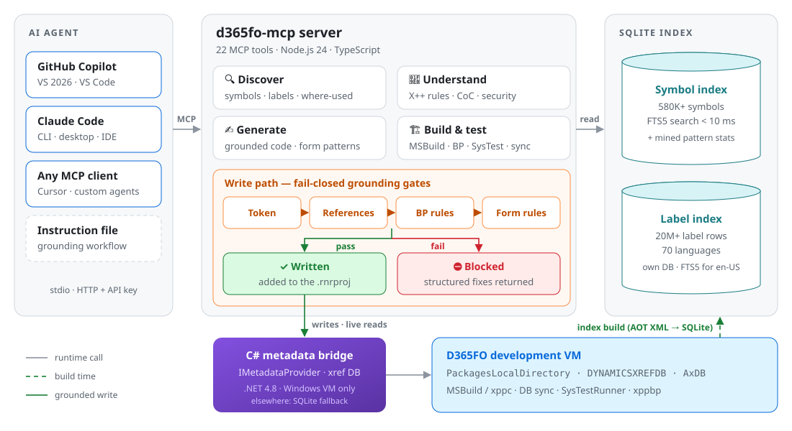
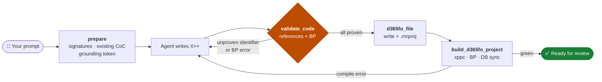
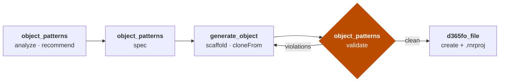
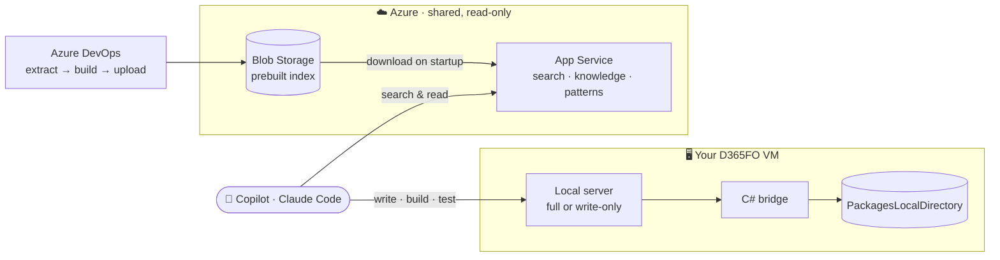
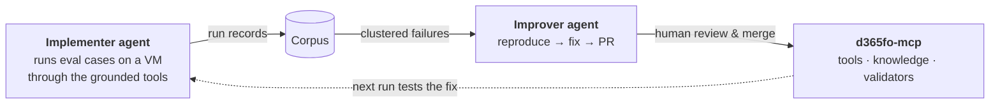

<div align="center">

# D365 F&O MCP Server

### Grounded AI development for Dynamics 365 Finance & Operations

**22 MCP tools that know every X++ class, table, form, EDT and label in *your* D365FO codebase —<br/>
so GitHub Copilot and Claude Code write X++ that compiles.**

[](https://www.npmjs.com/package/d365fo-mcp)
[](LICENSE)
[](https://nodejs.org/)
[](https://www.typescriptlang.org/)
[](docs/TESTING.md)
<!-- coverage-badge:start -->
[](eval/COVERAGE.md) [](eval/COVERAGE.md)
<!-- coverage-badge:end -->

[](https://insiders.vscode.dev/redirect/mcp/install?name=d365fo&inputs=%5B%7B%22type%22%3A%22promptString%22%2C%22id%22%3A%22d365fo_server_url%22%2C%22description%22%3A%22D365FO%20MCP%20server%20URL%20(e.g.%20https%3A%2F%2Fyour-server.azurewebsites.net%2Fmcp%2F)%22%7D%5D&config=%7B%22type%22%3A%22http%22%2C%22url%22%3A%22%24%7Binput%3Ad365fo_server_url%7D%22%7D)
[](https://insiders.vscode.dev/redirect/mcp/install?name=d365fo&quality=insiders&inputs=%5B%7B%22type%22%3A%22promptString%22%2C%22id%22%3A%22d365fo_server_url%22%2C%22description%22%3A%22D365FO%20MCP%20server%20URL%20(e.g.%20https%3A%2F%2Fyour-server.azurewebsites.net%2Fmcp%2F)%22%7D%5D&config=%7B%22type%22%3A%22http%22%2C%22url%22%3A%22%24%7Binput%3Ad365fo_server_url%7D%22%7D)
[](https://cursor.com/install-mcp?name=d365fo&config=eyJ1cmwiOiJodHRwczovL3lvdXItc2VydmVyLmF6dXJld2Vic2l0ZXMubmV0L21jcC8ifQ%3D%3D)

<sub>The install buttons connect an editor to a server that is already deployed — no server yet? Start with the [Quick start](#-quick-start).</sub>

[**Quick start**](#-quick-start) ·
[**How it works**](#-how-it-works) ·
[**What to ask**](#-what-to-ask) ·
[**Tools**](#-the-22-tools) ·
[**Docs**](#-documentation) ·
[**Changelog**](CHANGELOG.md)

</div>

---

## 💡 Why

AI assistants are excellent at C#, Python and JavaScript. X++ is different: your D365FO codebase is
private, deeply customized and invisible to every model — so the AI confidently writes code against
methods, fields and labels that do not exist, and it does not compile.

This server pre-indexes your whole D365FO installation — **580 000+ symbols** across standard, ISV
and custom models, plus **20M+ label rows** — and puts it behind MCP tools. Every signature, every
existing CoC wrapper, every label and every form pattern is checked against *your* metadata
**before** the AI writes a line, and a write that cannot be proven is refused.

| | Without this server | With this server |
|---|---|---|
| **Method signatures** | Guessed → compile errors | Exact, read from your codebase |
| **Existing CoC wrappers** | Manual AOT search | `extension_info(mode="coc")` in < 50 ms |
| **New forms** | Hand-written XML, broken patterns | Cloned from a reference form, validated against the platform's pattern rules |
| **Labels** | Hardcoded strings | The right existing `@SYS` / `@Module` label, found instantly |
| **Security chains** | Hours of manual tracing | Role → Duty → Privilege → Entry point in one call |
| **Generated code** | Hallucinated fields and types | Every reference proven against the index, gated before write |

---

## 🧭 How it works

<p align="center">
  
</p>

1. **Index** — the server extracts your AOT metadata once into two SQLite databases (symbols and
   labels, FTS5 search in < 10 ms). On a D365FO VM the **C# metadata bridge** adds live reads
   through Microsoft's own `IMetadataProvider` and compiler-resolved cross-references from
   `DYNAMICSXREFDB`.
2. **Ground** — before the agent writes anything, `prepare` hands it the real signatures, existing
   extensions, naming rules and a short-lived **grounding token** for the target object.
3. **Gate** — `validate_code` proves every type, field, method and label in the generated code and
   checks the best-practice rules; forms are also checked against the platform's pattern rules.
   Writes are **fail-closed**: anything unproven is blocked and the agent gets structured fixes.
4. **Build** — the write lands through the bridge (or a validated XML writer where the provider
   cannot express the object), is added to your `.rnrproj`, and can be compiled, BP-checked,
   synced and unit-tested from the same chat.

A typical change, end to end:



<details>
<summary><b>Form development pipeline</b> — patterns are rules, not suggestions</summary>

<br/>

Forms are the hardest artifact to generate correctly: each pattern dictates required containers,
their order and the allowed sub-patterns. The form pattern engine turns that into a guided
pipeline, grounded in pattern statistics mined from your own environment:



Violations the compiler would reject (wrong order, missing container, disallowed control)
**block the write**; recommendations only warn. Patterns without a reference form are expanded
deterministically, and a form's missing required controls can be repaired automatically.

</details>

---

## 🚀 Quick start

> [!IMPORTANT]
> From D365FO platform update **10.0.49 (PU74)**, **Visual Studio 2026** is the supported IDE for
> X++ development — Microsoft no longer supports VS 2022 there. Earlier platform versions still use
> VS 2022 ≥ 17.14. [Details](https://learn.microsoft.com/en-us/dynamics365/fin-ops-core/fin-ops/get-started/whats-new-platform-updates-10-0-49)

### 🖥️ Install on your D365FO VM — the usual case

One line in PowerShell installs Node.js if it is missing, installs the server from npm and runs the
setup wizard, which asks where the index should live and builds the C# bridge for you:

```powershell
irm https://raw.githubusercontent.com/dynamics365ninja/d365fo-mcp-server/main/install.ps1 | iex
```

Already have Node.js 24+? Skip the bootstrap:

```powershell
npm install -g d365fo-mcp
d365fo-mcp setup
```

Re-running either is safe. An installation made before the npm package existed is a git checkout;
both commands leave it where it is and update it in place.

### 🔌 Connect to a server your team already runs

Nothing to install — point your editor at it (or use the install buttons at the top):

```powershell
npx d365fo-mcp connect https://your-server.azurewebsites.net
```

### ☁️ Deploy one shared server for the whole team

The metadata index lives in Blob Storage and downloads automatically on startup.

[](https://portal.azure.com/#create/Microsoft.Template/uri/https%3A%2F%2Fraw.githubusercontent.com%2Fdynamics365ninja%2Fd365fo-mcp-server%2Frefs%2Fheads%2Fmain%2Finfrastructure%2Fazuredeploy.json)

Full guide, including the Azure DevOps pipelines that keep the index fresh:
[docs/SETUP_AZURE.md](docs/SETUP_AZURE.md).

> [!TIP]
> Every path ends with the **instruction file** (`CLAUDE.md` / `copilot-instructions.md`) that
> teaches the agent the grounding workflow, and a one-minute check that grounding really works.
> Both are in **[docs/QUICK_START.md](docs/QUICK_START.md)** — don't skip them.

<details>
<summary><b>Which deployment fits?</b> — local, shared or hybrid</summary>

<br/>



| Mode | Where | What it does |
|---|---|---|
| **Full** | your D365FO VM | Everything — search, generation, writes, build, tests. The simplest setup. |
| **Read-only** | Azure App Service | Shared index for the whole team; no writes, nothing installed on developer machines. |
| **Hybrid** | Azure + a local write-only companion | The team shares one index in Azure; each developer's VM only writes, builds and tests. |

Scenarios A–F in detail: [docs/SETUP.md](docs/SETUP.md) · server modes and tool profiles:
[docs/MCP_CONFIG.md](docs/MCP_CONFIG.md).

</details>

---

## 💬 What to ask

You never name tools — the agent picks them. Ask the way you would ask a colleague who knows the
codebase:

| You ask | The server |
|---|---|
| *"Add a CoC wrapper to `SalesLine.validateWrite` that blocks negative quantities"* | Reads the exact signature, lists existing wrappers, proves every reference, writes the extension class |
| *"Create a table `ContosoRentEquipmentTable` with a SimpleList form and labels in en-US and de"* | Checks names for collisions, reuses EDTs, picks the form pattern, creates labels, adds everything to the project |
| *"Who has access to the `VendPaymTerms` form?"* | Walks Role → Duty → Privilege → Entry point, including OLS policies |
| *"Is there a label for 'payment terms'?"* | Full-text search over every label file and language, custom models first |
| *"Where is `CustTable::find` called from?"* | Compiler-resolved cross-references from `DYNAMICSXREFDB` — every caller and reference type |
| *"Build the project, run BP and the SysTests"* | MSBuild with structured xppc diagnostics, xppbp, SysTestRunner — all from chat |

More real tool chains: [docs/USAGE_EXAMPLES.md](docs/USAGE_EXAMPLES.md).

---

## ✨ Capabilities

| | |
|---|---|
| 🔍 **Full-codebase intelligence** | Classes, tables, forms, EDTs, enums, security artifacts and 20M+ labels, indexed with FTS5 — search in < 10 ms. On a D365FO VM, live metadata and compiler cross-references through the C# bridge. |
| 🛡️ **Grounded generation** | Fail-closed gates: `prepare` issues grounding tokens, `validate_code` proves every identifier and enforces best-practice rules — hallucinated code never reaches disk. |
| 🧩 **Form pattern engine** | The full catalog of Microsoft form patterns and sub-patterns: recommends a pattern, clones reference forms with datasource re-binding, expands patterns that have no reference form, repairs missing required controls and blocks invalid writes. |
| ✍️ **Safe metadata writes** | Through Microsoft's own `IMetadataProvider` wherever it can express the object; structured XML writers with ambiguity guards for the rest — never blind string replacement. Automatic `.rnrproj` registration and one-call undo. |
| 🏷️ **Tags on writes** | `<Tags>` on created objects and added elements (`tags` argument or `D365FO_DEFAULT_TAG`), set or cleared on existing objects with `modify-property propertyPath="Tags"`. |
| 🏗️ **SDLC from chat** | MSBuild with structured diagnostics, DB sync, xppbp, SysTestRunner. Optional `restartAos: true` refreshes the local AOS after a build — [runtime restart](docs/AOS_RUNTIME_RESTART.md). |
| 📐 **X++ knowledge base** | Queryable rules for select grammar, CoC authoring, financial dimensions, `LedgerVoucher` posting, number sequences, `SysExtension`, Electronic Reporting and AX 2012 → D365FO migration — keeps deprecated APIs out. |

**Opt-in tools** — off by default and not even published until you configure them:

| | |
|---|---|
| 🗄️ **`axdb_sql`** | Read-only, parameterized queries against AxDB on the development VM, so the agent can check what the code actually persisted. Windows authentication, one SELECT validated on the parsed T-SQL tree, always rolled back. [Setup](docs/AXDB_SQL.md) |
| ⏱️ **`trace_d365fo`** | Captures the AOS's ETW events while a slow scenario is reproduced and shows where the time goes — per X++ method, and which SQL statements run thousands of times from one caller. No timer code added. [Setup and accuracy](docs/TRACE.md) |

---

## 🧰 The 22 tools

Several tools are unified behind a discriminator (`mode`, `action`, `domain`, `objectType`), so the
agent chooses from fewer, broader tools.

| Area | Tools |
|---|---|
| 🔍 **Discover** | `search` · `get_object_info` · `find_references` · `labels` |
| 🧠 **Understand** | `get_knowledge` · `analyze_code` · `extension_info` · `security_info` · `object_patterns` |
| 🛡️ **Ground & validate** | `prepare` · `validate_code` · `validate_object_naming` |
| ✍️ **Generate & write** | `generate_object` · `d365fo_file` · `update_symbol_index` |
| 🏗️ **Build & verify** | `build_d365fo_project` · `run_bp_check` · `run_systest_class` · `verify_d365fo_project` · `get_workspace_info` |
| 🧪 **Opt-in diagnostics** | `axdb_sql` · `trace_d365fo` |

Workspaces that already run other MCP servers can set `MCP_TOOL_PROFILE=core` to publish only the
17-tool create-and-build loop. Every tool, parameter and example prompt:
**[docs/MCP_TOOLS.md](docs/MCP_TOOLS.md)**.

No MCP client, or a script? `d365fo-mcp call <tool> key=value …` runs any of them from a shell
against a running server: [Tools from a shell](docs/QUICK_START.md#tools-from-a-shell).

---

## 🧪 How we keep it honest

Gates prove a *single* write is grounded. A self-improving **eval loop** checks that the server as a
whole keeps getting better at producing X++ that compiles, is BP-clean and matches the intended
metadata — on a real D365FO VM, against captured golden metadata and SysTest oracles.



The coverage badges at the top count a topic only when the knowledge base teaches it, an eval case
with a captured golden proves it, and the tool path can build it — see
[eval/COVERAGE.md](eval/COVERAGE.md) and [docs/AGENT_EVAL_LOOP.md](docs/AGENT_EVAL_LOOP.md). The loop
opens pull requests; humans review and merge them.

---

## 📚 Documentation

The full map, grouped by audience: **[docs/README.md](docs/README.md)**.

| Getting started | Reference | Operations |
|---|---|---|
| [Quick start](docs/QUICK_START.md) — connect or install | [All 22 tools](docs/MCP_TOOLS.md) | [Azure deployment](docs/SETUP_AZURE.md) |
| [Setup scenarios A–F](docs/SETUP.md) | [`.mcp.json` reference](docs/MCP_CONFIG.md) | [DevOps pipelines](docs/SETUP_AZURE.md#azure-devops-pipelines) |
| [Claude Code setup](docs/SETUP.md#claude-code-cli) | [Configuration](docs/CONFIGURATION.md) | [Custom / ISV models](docs/CUSTOM_EXTENSIONS.md) |
| [Usage examples](docs/USAGE_EXAMPLES.md) — real tool chains | [Architecture](docs/ARCHITECTURE.md) | [Testing](docs/TESTING.md) |
| [Changelog](CHANGELOG.md) | [Knowledge authoring](docs/KNOWLEDGE_AUTHORING.md) | [Coverage](eval/COVERAGE.md) — what the badge counts |
| [Backlog](docs/BACKLOG.md) — deferred work | [New tool checklist](docs/NEW_TOOL_CHECKLIST.md) | [Eval loop](docs/AGENT_EVAL_LOOP.md) — the self-improvement harness |

## 🤝 Contributing & security

Issues and pull requests are welcome — read [CLAUDE.md](CLAUDE.md) for the repository conventions
(every user-visible change gets a [CHANGELOG](CHANGELOG.md) entry) and
[docs/NEW_TOOL_CHECKLIST.md](docs/NEW_TOOL_CHECKLIST.md) before adding a tool. Please report
vulnerabilities privately as described in [SECURITY.md](SECURITY.md).

## 📄 License

Released under the [MIT License](LICENSE). By submitting a pull request you agree that your
contribution is licensed under the same MIT License.
