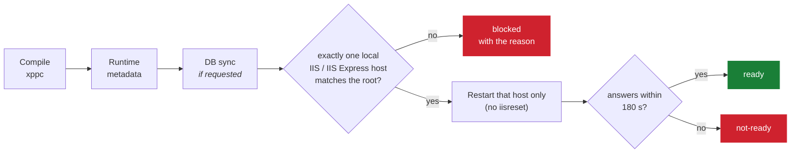

<sub>[README](../README.md) › [Docs](README.md) › AOS restart</sub>

# 🔁 Optional AOS restart after a build

On a Windows development environment, successful compilation and runtime metadata generation do not guarantee that the running AOS has loaded the new objects. A newly compiled menu item can remain unavailable in the browser until the runtime is refreshed. `build_d365fo_project` can perform that refresh when explicitly requested, avoiding a separate manual IIS/IIS Express restart.



Any failed step before the restart — compile errors, a skipped metadata step, an unsuccessful
requested sync — stops the chain: nothing is restarted.

## Request the restart with the build

```json
{
  "modelName": "MyModel",
  "restartAos": true
}
```

On a classic AOSService VM the environment root comes from the local AOS itself: `Infrastructure.HostUrl` in `AosService\WebRoot\web.config`, beside the `PackagesLocalDirectory` the build uses. The build result names the root and where it came from, the host that was restarted and the outcome. Pass `aosUrl` to override it, and on UDE, which has no local AOS and so no such file:

```json
{
  "modelName": "MyModel",
  "restartAos": true,
  "aosUrl": "https://your-local-development-environment/"
}
```

`aosUrl` is the environment root, not the MCP endpoint or a menu item URL. The restart uses it to choose the one local IIS/IIS Express host whose binding matches it, and then polls it to confirm the AOS answers again. Add `dbSync: true` or an explicit table list when database synchronization is needed. Supply these options on the initial build request. The existing `wait: true` default is unchanged; `wait: false` lets the client collect the result later. The readiness check can add up to three minutes to the call. That fits the default 30-minute `waitTimeoutMs`; what can run out is the client's own request timeout. Progress notifications continue every 10 seconds and name the step (sync, then "restarting the AOS and waiting until it answers"), which keeps a client that honours `progressToken` waiting. With a client that times out a long request regardless, use `wait: false`. Either way the build and restart continue, a later call collects the result without repeating the restart, and a snapshot or timed-out wait taken meanwhile says the AOS is restarting rather than that the build is still compiling.

> [!NOTE]
> Omitting `restartAos` preserves the existing build workflow. This feature does not require a
> browser tool or browser configuration.

## Prerequisites and host selection

The restart requires successful compilation, runtime metadata generation and any requested database synchronization. A skipped or failed metadata step, an xppc log that still reports errors, or an unsuccessful requested sync prevents the restart.

The environment hostname must resolve exclusively to local addresses and match exactly one root application binding. Supported hosts are:

- **IIS:** the running `AOSService` application pool. The MCP process must have administrative privileges.
- **IIS Express:** an instance owned by the MCP process's Windows user, launched from the installed IIS Express executable. Its process identity, configuration and original arguments are checked before stopping it; only the selected instance is restarted, with its original arguments and a hidden window.

For example, this IIS Express launch is supported:

```powershell
& "C:\Program Files\IIS Express\IISExpress.exe" /config:"C:\Users\Developer\Documents\IISExpress\config\applicationHost.config" /apppool:Dynamics365
```

Explicit `/site` and `/siteid` selectors are also supported. Ambiguous matches, changed configuration, insufficient permissions and unsupported launch arguments block the operation with an explanation. The tool does not run a machine-wide `iisreset` or stop unrelated IIS Express instances. IIS Express detection does not depend on the classic IIS service being active.

## Readiness and failure reporting

After restart, the tool checks for a replacement worker and polls the environment for up to 180 seconds. It follows at most five redirects within the environment's origin. A successful HTTP response, an authentication challenge, or an HTTPS redirect to the recognized Entra login hosts can establish host readiness after the replacement process is verified; external redirects are not followed.

Results distinguish `ready`, `blocked`, `failed` and `not-ready`. A restart problem is reported explicitly so the user knows a manual runtime refresh or investigation may be needed.

> [!IMPORTANT]
> HTTP readiness does not prove that a customization meets its requirement: inspect or test the
> new objects separately.

The original restart request and its outcome are retained. Collecting a completed build result does not repeat the restart or its prerequisite database synchronization, and re-issuing the same `restartAos: true` request collects that result again. Once the result has been returned, a call without `restartAos` is treated like any build after its result was collected: it compiles again (and restarts nothing). Interrupted or uncertain restart work is not retried automatically. An overlapping build is blocked while that work is active or uncertain.

This coordination covers MCP processes sharing the same temporary directory, normally those running under the same Windows user. It does not coordinate builds under other Windows accounts or external tools. Finish any Visual Studio builds or other external compilation/synchronization jobs before requesting a restart.

If the MCP server that ran the workflow exits before the restart stage (while compiling, or during the best-practice check or database sync), the next build releases its reservation and says so: nothing irreversible had happened to the AOS yet. It waits while that build's `xppc` is still running.

> [!WARNING]
> If the server exits during the restart itself, the outcome is unknown and recovery is manual:
>
> 1. Stop the MCP server and confirm that no build, sync or restart is still active.
> 2. Inspect the runtime and the saved build result.
> 3. Only after resolving the uncertainty, remove the reservation file identified in the warning
>    (`d365build_aos_restart.json` in the process's temporary directory).
> 4. Restart the MCP server and request a fresh build with `fullBuild: true` and the desired
>    restart options.
>
> Do not remove the reservation merely because it is old.

## Verification

Automated tests cover host selection, local-address restrictions, launch arguments, readiness, build prerequisites and result collection. The Windows PowerShell harness mocks process mutations; these tests do not restart a live AOS.

Both host kinds have been tested live on cloud-hosted development VMs. In each run `restartAos: true` without `aosUrl` read the root from `web.config`, restarted the host and reported `ready` after the authentication challenge:

- **IIS Express** with `/config` and `/apppool:Dynamics365`: the one matching instance was restarted.
- **IIS `AOSService` application pool**, with five bindings on the site and a second pool (`RetailCloudPos`) on the machine: the one binding matching the root was selected, `AOSService` was recycled, the old worker process was replaced by a new one, and the other pool was left untouched. An incremental build of a small model took 22 s; the whole call, including the restart and the readiness check, took 94 s.
