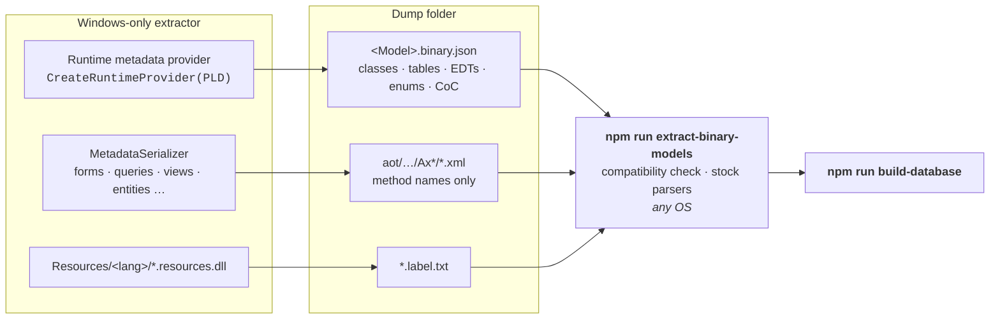

<sub>[README](../README.md) › [Docs](README.md) › Binary ISV models</sub>

# 📦 Binary ISV models (signatures only)

Some ISVs ship a model as compiled output only (`<Package>\bin\*.netmodule`, no `AxClass`/`AxTable`/`AxForm` XML).
`extract-metadata` walks object XML and therefore sees nothing, so `search`, `get_object_info`, `labels`,
`security_info`, `extension_info` and `validate_code(mode="references")` know nothing about that ISV's API.
Agents then invent members or give up.

This path indexes such a model **signatures-only**: no method bodies and no source are produced or stored.
Everything that is not code (forms, queries, views, data entities, maps, menu items, security, extensions,
label texts) is read in full, because the compiled model still carries it.

> [!IMPORTANT]
> **The dump step is Windows only.** The reader is Microsoft's own runtime metadata provider
> (`MetadataProviderFactory.CreateRuntimeProvider`), which needs the platform assemblies. Everything
> after the dump step runs on any OS.

## How it works



<details>
<summary>The same pipeline, step by step</summary>

```
BinaryModelExtractor.exe     (.NET Framework 4.8, Windows; needs <PLD>\bin and <PLD>\StaticMetadata)
   CreateRuntimeProvider(<PLD>)                                  -> <dump>\<Model>.binary.json   classes, tables, EDTs, enums,
                                                                                                  chain-of-command, platform info
   MetadataSerializer on forms/queries/views/entities/...        -> <dump>\aot\<Module>\<Module>\Ax*\*.xml   (method names only)
   Resources\<lang>\*.resources.dll                              -> <dump>\aot\...\AxLabelFile\LabelResources\<lang>\*.label.txt
npm run extract-binary-models -- <dump> --out <metadataDir>      (any OS)
   compatibility check -> stock extract-metadata over <dump>\aot -> class/table/EDT/enum JSON -> labels copied
npm run build-database                                           (unchanged; also indexes <metadataDir>\<Module>\AxLabelFile)
```

</details>

The object XML goes through the **stock** `extract-metadata` parsers, so a binary form, view or security role is indexed
exactly like a source one. Only classes, tables, EDTs and enums need the dump JSON, because the provider returns them as
structured signatures while a compiled `AxMethod` has no `Source` text for the XML parsers to read.

## With the d365fo-mcp CLI (npm install or checkout)

`d365fo-mcp index` runs all of the steps below for you, whether the server was installed with
`npm install -g d365fo-mcp` or from a checkout. Tell it which models to read:

```jsonc
// config/d365fo-mcp.json (or instances/<name>/d365fo-mcp.json)
{
  "index": { "binaryIsvModels": ["ContosoIsv*", "!ContosoIsvDemo"] }
}
```

`d365fo-mcp setup` and `d365fo-mcp instance add` ask this for you. On a traditional VM they list
the packages in the packages path that ship compiled output and no object XML, with the publisher
from their descriptor, and preselect the ones not published by Microsoft.

Every `d365fo-mcp index` (and the reindex that `d365fo-mcp update` offers) then runs:

1. `extract-metadata`, as before;
2. **binary ISV models**: builds BinaryModelExtractor against `<packagePath>\bin` the first time,
   and again whenever an update changes its sources or the platform is upgraded. An npm install
   keeps it in `<installation directory>\binary-extractor`, where updates do not delete it. The step
   then dumps the models into `binary-isv-dump\` beside the configuration and imports them, with
   the label languages of `index.labelLanguages`;
3. `build-database`. A `custom` build also covers the imported models.

Because the import runs after the extraction every time, a full rebuild (`extractMode: "all"`,
which empties `METADATA_PATH`) keeps the models.

| Command | What it does |
|---|---|
| `d365fo-mcp index` | extraction + binary ISV models + database |
| `d365fo-mcp index --binary-only` | binary ISV models + a database build of only those models (after an ISV update) |
| `d365fo-mcp index --force-binary` | imports models whose references mostly do not resolve (see [Platform compatibility](#platform-compatibility)) |

The dump needs Windows, the .NET SDK and a full `PackagesLocalDirectory` (`environment.packagePath`).
Where there is none (Linux, macOS, UDE, an Azure-hosted index), make the dump on a Windows machine
as in [Manual run](#manual-run-checkout-pipelines) and point the server at it:

```json
{ "index": { "binaryIsvDumpPath": "D:/isv-dump" } }
```

`index` then imports that folder as it is and dumps nothing. If the binary step fails (no .NET SDK,
platform mismatch), the index is still built without the models. A warning names the cause and the
`--binary-only` command to run once it is fixed.

## Manual run (checkout, pipelines)

1. **Platform.** Use a full `PackagesLocalDirectory` (a build agent's NuGet-restored platform and application packages, or a
   dev box). Put the ISV package beside the others: `<PLD>\<ISVPackage>\bin\*` and `<PLD>\<ISVPackage>\Resources\*`
   (junctions or symlinks are fine; read access is enough, nothing is written to the package).
   A PLD that holds only the ISV package works, but base types cannot be verified (the importer warns).
2. **Build the extractor** (needs the .NET SDK; it compiles against the platform's own assemblies):

   ```
   dotnet build bridge/BinaryModelExtractor -c Release -p:D365BinPath=<PLD>\bin -o <extractorDir>
   ```
3. **Dump** the models you want (names or masks, by module or display name: `Contoso*`, `*,!ContosoDemo*`; omit `--models` for every non-kernel model):

   ```
   <extractorDir>\BinaryModelExtractor.exe --packages-path <PLD> --out <dump> --models "Contoso*,!ContosoDemo*" [--languages en-US,cs|all] [--no-aot]
   ```
4. **Import and index** (any OS; copy `<dump>` over if step 3 ran elsewhere):

   ```
   npm run extract-binary-models -- <dump> --out <metadataDir>     # METADATA_PATH by default
   npm run build-database
   ```

   Run it **after** `extract-metadata` in the same build: the import merges its models into the extract manifest as
   non-Microsoft, which keeps them out of the mined standard-pattern statistics.

`LABEL_LANGUAGES` still selects which of the dumped languages are indexed (`--languages` on the extractor only limits what is dumped).

### Platform kernel

`BinaryModelExtractor --kernel` also dumps what the provider serves from `StaticMetadata` (`Common`, `xRecord`,
`Object`, the kernel classes and tables) as the model `Kernel`, with the platform's version. An import writes it
like any other model but does not record it as custom. Tools that need the full inheritance of a table or class
(the version scripts resolve a method through `extends` up to `Common`) take it from there.

## What is indexed

| Object | What the tools get | Source in the dump |
|---|---|---|
| Classes, interfaces | base class, interfaces, `final`/`abstract`/`internal`, `///` class summary, member variables, attributes (`ExtensionOf`, `Hookable`, `Wrappable`, `Replaceable`, `SysObsolete`, `SubscribesTo`, ...), methods with visibility, modifiers, return type, parameters with X++ types, EDT names and default values | provider |
| Tables | fields (type, EDT/enum, mandatory, label), indexes, relations with constraints, method signatures | provider |
| EDTs, enums | extends, size; values | provider |
| Forms | data sources (tables, fields), top-level and nested controls with their data bindings, form and data-source method **names**, patterns | serialized XML |
| Queries, views | data-source tree, ranges, joins; view fields and query reference | serialized XML |
| Data entities | public names, keys, mapped/unmapped fields, data sources, DMF flags | serialized XML |
| Maps | fields, mappings, method names | serialized XML |
| Menu items (display/action/output) | target object, label | serialized XML |
| Security | privilege -> entry points (menu item, grants), duty -> privileges, role -> duties; so the security chain (`menu item -> privilege -> duty -> role`) works | serialized XML |
| Extensions of platform objects | table/form/enum/EDT/view/query/map/menu/menu item/role/duty extensions | serialized XML |
| Services, service groups, config and license keys, security policies | as in source models | serialized XML |
| Labels | label **texts** per language, so `labels` and `get_object_info` show text, not only `@File:Id` | `Resources\<lang>\<LabelFileId>.resources.dll` |

Every class, table, EDT and enum entry says **"binary ISV, signatures only"** and every object carries the vendor, model
version and the platform it was read with (`binaryIsv` on the record, `sourcePath` is `binary-isv://<Module>/<Kind>/<Name>`).

### Chain of Command in binary extension classes

A compiled class has no body to scan for `next`. The X++ compiler, however, records every wrap in
`bin\Dynamics.AX.<Module>.ChainOfCommand.xml` (extension class, target, wrapped methods, static/instance, nested form target).
The extractor reads that file, so `extension_info(mode="coc", target=<class>)` lists binary wrappers and the wrapped
methods exactly as for source models, and the wrapper methods are tagged `coc-wrapper`.

### Platform compatibility

A compiled model carries no stamp of the platform build it was compiled against, so the importer checks what the provider can resolve:

- every application module the ISV references must be present in the packages path, otherwise **warning** ("base types cannot be verified");
- every base class, interface, EDT, enum and related table that the ISV's objects point at must exist in the platform it is read with;
  a few misses are a **warning**, more than 25 % misses is an **error** ("built against another application version") and the import stops
  unless `--force` is given;
- objects the provider could not read are listed.

The platform build (provider file version and application module versions) is printed and stored on every record.

## Limits

- **No bodies, no method doc-comments** (`AxMethod.Source` and `XMLDocumentation` are empty in a compiled model). Form and entity methods are listed by name only.
- Windows-only dump step; the extractor must be built against the platform it will read with.
- Method parameters of CoC-wrapped **form** methods are not available (only names); table, class and extension classes are complete.
- `validate_code` can ground calls into the ISV (unknown static member, arity, unknown instance method). It cannot tell that a CoC wrapper wraps a method the base does not have; for that use `extension_info(mode="coc")` or `get_object_info`.
- Reports (SSRS designs), workflows, KPIs and tiles are not exported.
- The class path stores `Declaration` (header and member variables) only. Nothing resembling method source is written; the serialized XML is scanned for `<Source>` text and any found is blanked.

> [!CAUTION]
> Check the ISV's license before storing a dump: it contains the ISV's API surface (not its code)
> and should be treated as private data.

## Azure DevOps pipeline

The data pipelines (`.azure-pipelines/d365fo-mcp-data-extract-and-build-*.yml`) run on Ubuntu, so the dump step lives in an
optional **Windows** job and the import is one extra step between "Extract models from Git source" and "Build database".

```yaml
# Job 1 (Windows agent that has the platform and the ISV package; run on ISV update only)
- job: DumpBinaryIsv
  pool: { vmImage: 'windows-latest' }
  steps:
    - script: dotnet build bridge/BinaryModelExtractor -c Release -p:D365BinPath=$(PLD)\bin -o $(Build.BinariesDirectory)\extractor
    - script: $(Build.BinariesDirectory)\extractor\BinaryModelExtractor.exe --packages-path $(PLD) --out $(Build.ArtifactStagingDirectory)\isv-dump --models $(binaryIsvModels)
    - publish: $(Build.ArtifactStagingDirectory)\isv-dump
      artifact: isv-dump          # private: it holds the ISV's API surface

# In the existing Ubuntu job, after 'Extract models from Git source'
- download: current
  artifact: isv-dump
- script: npm run extract-binary-models -- $(Pipeline.Workspace)/isv-dump --out $(METADATA_PATH)
  displayName: 'Import binary ISV models (signatures only)'
  workingDirectory: '$(MCP_SERVER_PATH)'
```

`npm run blob-manager upload-custom` then uploads the binary models with the other custom metadata.
