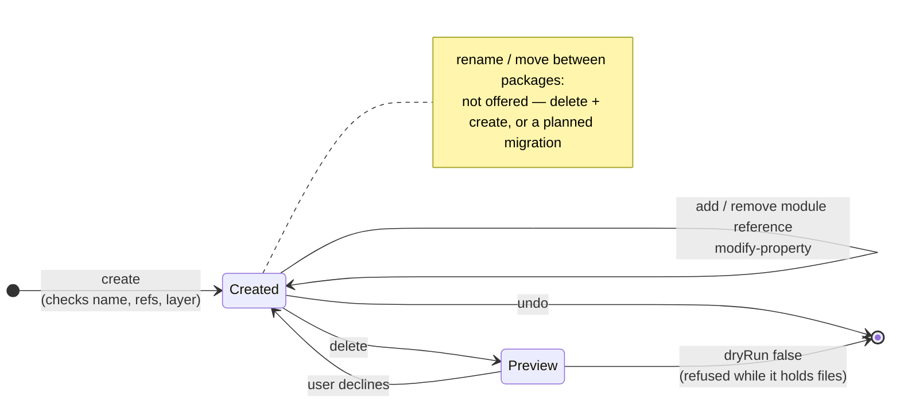

[README](../README.md) › [Docs](README.md) › Model lifecycle

# 🔄 Model lifecycle

A D365FO model is its descriptor: `<root>/<Package>/Descriptor/<Model>.xml`, an `AxModelInfo`
document, plus the folder `<root>/<Package>/<Model>/` that holds its `Ax*` folders. The server
covers the lifecycle of one through `objectType="model-descriptor"` on `d365fo_file` and
`objectType="model"` on `get_object_info`. No new tool and no new published operation: the
discriminators were already in the schema.

| What | Call |
|---|---|
| List models, find problems | `get_object_info(objectType="model", name="*")` |
| Inspect one model | `get_object_info(objectType="model", name="ContosoExt")` |
| Create | `d365fo_file(action="create", objectType="model-descriptor", objectName="ContosoScripts", properties:{…})` |
| Add / remove a module reference | `d365fo_file(action="modify", objectType="model-descriptor", operation="add-module-reference" \| "remove-module-reference", params:{moduleReference})` |
| Edit a property | `d365fo_file(action="modify", objectType="model-descriptor", operation="modify-property", params:{propertyPath, propertyValue})` |
| Delete | `d365fo_file(action="delete", objectType="model-descriptor", objectName="ContosoScripts", params:{dryRun:false})` after the user has seen the preview (a call without `dryRun` only previews) |
| Undo a create | `d365fo_file(action="undo", filePath="<descriptor>")` |
| Rename, move between packages | Not offered — see [Why there is no rename](#why-there-is-no-rename) |

The parameter contracts are served by `get_knowledge(kind="op-spec", topic="model")` (the whole
lifecycle) and `topic="model-descriptor"` (the create contract).

## Where a model is created

Under the custom write root: `D365FO_CUSTOM_PACKAGES_PATH` when it is set — on a UDE
environment that is the repository's metadata folder (`ModelStoreFolder`), with Microsoft's
packages in a separate, read-only framework directory — otherwise the configured
`PackagesLocalDirectory`. `packagePath` on the call overrides it. Nothing is created under a
guessed root: with no root configured the create is refused.

Descriptors are read from every configured root (the caller's, the custom one, the configured
one, Microsoft's), so a name, a package or an Id that is taken anywhere is seen.

## Create

`objectName` is the model's name and is never defaulted. Everything else has a default:

| Property | Default |
|---|---|
| `displayName` | the name |
| `description` | empty |
| `layer`, `publisher` | the workspace's own model, else the most common pair among the custom models under the same root. With no model to copy from, the create is refused and the agent asks the user |
| `version` | `1.0.0.0` |
| `moduleReferences` | `["ApplicationPlatform"]` |
| `packageName` | a new package named like the model |
| `id` | a number in the band Visual Studio uses for new models that no visible descriptor has |
| `project` | none — pass `{projectName?, projectsRoot?, solutionMode?}` to also create a VS project |

Checked before anything is written:

- the name is a letter followed by letters, digits or `_` (it becomes a folder, a file and an
  assembly name), and no model of that name exists under any root, in any casing;
- every module reference names a package folder that exists under a configured root. A typo is
  the usual cause of a miss; a package that really is absent on this box and present on the
  build agent takes `allowUnresolvedReferences: true`;
- no reference to the model's own package, and no reference cycle;
- the layer is `isv` or above — Microsoft's layers are refused;
- `packageName` naming an existing package adds the model to it. The model then compiles into
  that package's assembly, so this is held to the cross-model guard, and a Microsoft package is
  refused outright.

> [!WARNING]
> The Id is only as unique as what is visible: a model that exists in another repository or on
> another branch cannot be seen from here. The reply says so.

The descriptor is written the way Visual Studio writes one — UTF-8 with BOM, CRLF, two-space
indent, elements in the serializer's alphabetical order.

### The new model and the cross-model guard

The workspace still targets the model its project builds; a new model is a *different* model,
and the cross-model guard would refuse the first object written into it. A model this server
created is therefore recorded in the server's `.env`:

- `CUSTOM_MODELS` — so it is classified as custom, not standard;
- `D365FO_CROSS_MODEL_WRITE_MODELS` — so objects can be written into it with
  `modelName="<Model>"`.

Both are also applied to the running server, and the reply lists exactly what was written
where. A key the server's real environment owns (the shell, or the `env` block of the MCP
client's configuration) cannot be persisted from here — `.env` is outranked by it — so the
change then lasts for the session only and the reply says that instead of reporting it saved.
Deleting or undoing the model takes the entries out again.

> [!NOTE]
> This is the one place the server edits its own write policy. It does so only for a model it
> has just created, which holds nobody's code; the allow-list for an *existing* model is still
> the user's to edit.

## Edit

`add-module-reference` and `remove-module-reference` are unchanged, with one addition: a
reference that closes a cycle is reported in the reply. Passing `params:{internalsVisibleTo:"<TestModel>"}`
instead of `moduleReference` edits the descriptor's `<InternalsVisibleTo>` the same way, which is how a
product model lets its test model see its internal members.

`modify-property` takes `Description`, `DisplayName`, `Publisher`, `Layer` (name or number),
`Version` (`"1.2.0.0"`) or one of `VersionMajor` / `VersionMinor` / `VersionBuild` /
`VersionRevision`. `Name`, `ModelModule` and `Id` are refused: they are the model's identity,
and changing them is a rename or a move. An unchanged value is reported, not rewritten. BOM,
line ends and every other byte of the file are kept.

Only the workspace's own model (or one on the allow-list) can be edited; a Microsoft descriptor
never.

## Delete

`dryRun` defaults to `true`: a delete call only previews. Show the user the list, and after they agree re-send with `dryRun: false`. The preview names the descriptor,
every file in the model folder, what happens to the package folder, the models that reference
the package, the VS projects, and whether the delete would be refused.

Refused unless `force: true`:

- the model still contains files;
- it is the last model of its package and another model's `<ModuleReferences>` still names that
  package. (A reference names the *package*, so removing one model of several breaks nothing.)

Refused always: a Microsoft model, a model outside the write roots, a model the cross-model
guard does not allow, and a package or model folder that is a symbolic link or junction —
deleting through a link removes files somewhere else.

What goes: the descriptor and the model folder. When it was the package's last model and the
package folder holds nothing but build output (`bin`, `XppMetadata`, `Resources`, …) the whole
package folder goes; anything unrecognised keeps the folder, and the reply lists it. The
model's VS projects are taken out of their solutions and the project files left on disk. The
`.env` entries are removed. Other models' descriptors are never edited — with `force`, the ones
left referencing a package that no longer exists are named in the reply.

> [!CAUTION]
> Recovery is `git restore` when the metadata is under source control, and nothing otherwise.
> A model already deployed to an environment stays installed there until it is uninstalled.

## Why there is no rename

A rename has to change the model's name everywhere it appears. Some of those places a tool can
rewrite:

- the descriptor file name, and its `Name`, `DisplayName` and `ModelModule`;
- the model folder, and the package folder when the package is named after the model;
- every *other* descriptor whose `<ModuleReferences>` names the package;
- the `<Model>` property of each `.rnrproj`, and the solution entries;
- files named after the model, such as `{Model}_BPSuppressions.xml`.

The rest it cannot rewrite safely, or cannot reach at all:

- **Label file ids.** A model's label file is usually named after it, and the id is in every
  `@Id:Label` reference in every object and in every other model that uses its labels.
  Renaming the id is a rewrite of the whole code base; not renaming it leaves a model whose
  labels carry the old name forever.
- **Object names.** Extensions are named `Table.Model` and `Class_Model_Extension`, and
  prefixes are often derived from the model name. Those names are referenced from code,
  security, menus and — once deployed — data.
- **Compiled output.** The package's assembly is `Dynamics.AX.<Package>.dll`, with matching
  `XppMetadata` and `Resources` folders. They are regenerated by a build, but anything that
  references the old assembly keeps failing until it is rebuilt too.
- **Everything outside the metadata.** Build pipelines, deployable-package definitions, the
  server's own configuration (`D365FO_MODEL_NAME`, `CUSTOM_MODELS`, the allow-list), source
  control history — a folder rename is a delete and an add there.
- **Deployed environments.** Where the model is already installed, a renamed model is a *new*
  model. The old one stays installed, with its objects, until someone uninstalls it — and two
  models then define the same objects.

A rename that does the first list and not the second leaves a model that builds on this
machine and nowhere else, which is worse than not renaming. So:

- a model that has not left this machine and holds nothing yet is renamed by delete + create;
- anything else is a migration the team plans — new model, objects moved, old model retired
  through a release — not a tool call.

Moving a model to another package is the same problem (`ModelModule`, the folders, every
reference to the old package, the assembly) and is not offered either.

## What is not covered

- **Unused module references.** Deciding that a reference is unused needs the compiler's view
  of every object in the model; nothing here reads the source. A reference missing for code
  that was actually written is reported by `build_d365fo_project`.
- **Ids across repositories.** See above.
- **The symbol index.** A descriptor is not an indexed object and a new model has no objects,
  so a create indexes nothing; objects written into the model are indexed as they are written.
  A forced delete drops the symbols of the files it removed.
