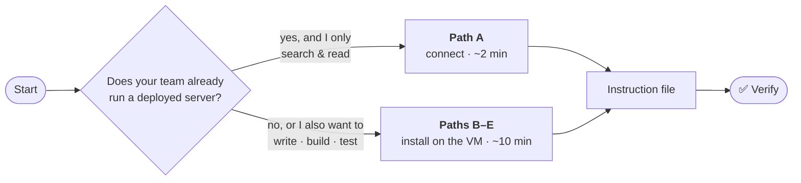

<sub>[README](../README.md) › [Docs](README.md) › Quick start</sub>

# 🚀 Quick start

Two very different jobs share this page. Pick yours — each path is self-contained, so you only read
your own. Both end with the shared [instruction file](#the-instruction-file-required) and
[verification](#verify) steps.

| Your situation | Path | Effort |
|---|---|---|
| You are setting up your own D365FO VM — **the usual case** | [**B–E — Install**](#paths-be--install-on-your-d365fo-vm) | 10 min, or ~25 with a local index |
| Your team already runs a deployed server | [**A — Connect**](#path-a--connect-to-a-server-someone-else-deployed) | ~2 min, nothing installed |
| One machine serving several D365FO environments | **F — Multi-instance** | [SETUP.md](SETUP.md#scenario-f--multiple-instances) |

> [!NOTE]
> Deploying the shared Azure server for your team is a separate job, for whoever administers it:
> [SETUP_AZURE.md](SETUP_AZURE.md).



---

## Path A — connect to a server someone else deployed

Only if someone has already deployed a shared server for your team — otherwise skip to
[Paths B–E](#paths-be--install-on-your-d365fo-vm).

Nothing is installed locally: the whole configuration is one entry naming a remote URL. You need
only your editor and the server URL from whoever deployed it (plus an API key, if that deployment
enforces one).

### Option 1 — the CLI writes it

```powershell
npx d365fo-mcp connect https://your-server.azurewebsites.net
```

Asks which editor and whether a key is needed, checks that the server answers before writing
anything, then merges the entry into that editor's config — any other MCP servers you have are left
alone. Claude Code is registered through its own `claude mcp add-json`.

Scriptable: `npx d365fo-mcp connect <url> --client vs|vscode|cursor|claude --api-key <key> --yes`.

### Option 2 — one click

[](https://insiders.vscode.dev/redirect/mcp/install?name=d365fo&inputs=%5B%7B%22type%22%3A%22promptString%22%2C%22id%22%3A%22d365fo_server_url%22%2C%22description%22%3A%22D365FO%20MCP%20server%20URL%20(e.g.%20https%3A%2F%2Fyour-server.azurewebsites.net%2Fmcp%2F)%22%7D%5D&config=%7B%22type%22%3A%22http%22%2C%22url%22%3A%22%24%7Binput%3Ad365fo_server_url%7D%22%7D)
[](https://insiders.vscode.dev/redirect/mcp/install?name=d365fo&quality=insiders&inputs=%5B%7B%22type%22%3A%22promptString%22%2C%22id%22%3A%22d365fo_server_url%22%2C%22description%22%3A%22D365FO%20MCP%20server%20URL%20(e.g.%20https%3A%2F%2Fyour-server.azurewebsites.net%2Fmcp%2F)%22%7D%5D&config=%7B%22type%22%3A%22http%22%2C%22url%22%3A%22%24%7Binput%3Ad365fo_server_url%7D%22%7D)
[](https://cursor.com/install-mcp?name=d365fo&config=eyJ1cmwiOiJodHRwczovL3lvdXItc2VydmVyLmF6dXJld2Vic2l0ZXMubmV0L21jcC8ifQ%3D%3D)

VS Code prompts for the URL; Cursor installs a placeholder you then edit. Visual Studio and Claude
Code have no install link — use Option 1 or 3.

### Option 3 — by hand

Visual Studio reads `%USERPROFILE%\.mcp.json` (all solutions) or a `.mcp.json` next to a specific
`.sln`:

```json
{
  "servers": {
    "d365fo-mcp-tools": { "url": "https://your-server.azurewebsites.net/mcp/" }
  }
}
```

With an API key, add it as a header:

```json
{
  "servers": {
    "d365fo-mcp-tools": {
      "url": "https://your-server.azurewebsites.net/mcp/",
      "headers": { "X-Api-Key": "your-key" }
    }
  }
}
```

Claude Code keeps its config elsewhere:

```powershell
claude mcp add-json --scope user d365fo-mcp-tools '{"type":"http","url":"https://your-server.azurewebsites.net/mcp/","alwaysLoad":true}'
```

> [!NOTE]
> **Read-only.** An Azure client searches and reads your indexed metadata but cannot write files on
> your VM. For writes, use the hybrid setup in [Path B](#b--hybrid--azure-search--local-writes).

**Using Copilot?** Also do the [Copilot switches](#enable-copilot-visual-studio) below. Then continue
with the [instruction file](#the-instruction-file-required).

---

## Paths B–E — install on your D365FO VM

### 1. Prerequisites

| Requirement | Where to get it | Needed for |
|---|---|---|
| Visual Studio 2026 (or 2022 ≥ 17.14) | Visual Studio Installer | all scenarios |
| GitHub Copilot extension | VS → Extensions | Copilot users |
| .NET SDK | pre-installed on D365FO VMs, else [dotnet.microsoft.com](https://dotnet.microsoft.com/download) | C# bridge (writes) |
| Node.js 24.x LTS | [nodejs.org](https://nodejs.org), or `Install-D365SupportingSoftware -Name node.js` | installed for you by the one-liner |
| Git | [git-scm.com](https://git-scm.com) | only for a git-checkout installation, or to work on the source |

> [!IMPORTANT]
> From platform update **10.0.49 (PU74)**, **Visual Studio 2026** is the only supported IDE for X++
> development (VS 2022 is no longer supported); earlier platform versions still use VS 2022 ≥ 17.14.
> [Details](https://learn.microsoft.com/en-us/dynamics365/fin-ops-core/fin-ops/get-started/whats-new-platform-updates-10-0-49)

### 2. Install

```powershell
irm https://raw.githubusercontent.com/dynamics365ninja/d365fo-mcp-server/main/install.ps1 | iex
```

The installer checks for Node.js (installing it if missing), installs the server with
`npm install -g d365fo-mcp`, and hands off to the setup wizard. The wizard:

1. selects your scenario,
2. asks where the configuration and the index should live,
3. builds the C# bridge,
4. asks only the settings that scenario needs,
5. builds the index if you want one,
6. prints the `.mcp.json` block for [step 3](#3-configure-your-editor).

With Node.js 24+ already present the one-liner has nothing to bootstrap, so
`npm install -g d365fo-mcp` followed by `d365fo-mcp setup` does the same thing.

Safe to re-run. Installations made before the npm package became self-contained are git checkouts
that hold their configuration and index inside the checkout; those are detected and updated in
place (`git pull`) instead, so nothing moves and no index is rebuilt. Override with environment
variables set on the same line:

| Variable | Effect |
|---|---|
| `$env:D365FO_MCP_DIR` | where to look for an existing checkout (default `K:\d365fo-mcp-server`) |
| `$env:D365FO_MCP_YES = '1'` | non-interactive, accept defaults |
| `$env:D365FO_MCP_NO_WIZARD = '1'` | install only, skip the wizard |

Answers are saved to `config/d365fo-mcp.json` (secrets to `config/secrets.json`) — there is no
`.env` to fill in. Every key, its default and the matching environment variable:
[CONFIGURATION.md](CONFIGURATION.md). An older `.env` keeps working and is imported the first time
the wizard runs.

> [!TIP]
> **The npm package is the installation.** [`d365fo-mcp`](https://www.npmjs.com/package/d365fo-mcp)
> carries the compiled server, the index scripts and the C# bridge sources, so
> `npm install -g d365fo-mcp` followed by `d365fo-mcp setup` needs no clone. The one-liner exists to
> install Node.js first, which npm cannot do for itself. Only `npx d365fo-mcp` without a global
> install stays a `connect`-only client, since it has nowhere to keep an installation.

<details>
<summary><b>Prefer to run the steps yourself?</b> — from a git checkout</summary>

<br/>

```powershell
git clone https://github.com/dynamics365ninja/d365fo-mcp-server.git K:\d365fo-mcp-server
cd K:\d365fo-mcp-server
npm install
cd bridge\D365MetadataBridge; dotnet build -c Release; cd ..\..   # required for writes
npm run build
npm run setup        # scenario, paths, models, prefix, label languages…
npm run doctor       # verifies Node, build, index, bridge
```

A local index (skip it for hybrid — that index lives in Azure):

```powershell
npm run extract-metadata
npm run build-database
```

</details>

### 3. Configure your editor

#### Enable Copilot (Visual Studio)

1. [github.com/settings/copilot/features](https://github.com/settings/copilot/features) → enable
   **MCP servers in Copilot**
2. Visual Studio → **Tools → Options → GitHub → Copilot** → enable **MCP server integration in agent
   mode**
3. Copilot Chat → switch to **Agent Mode**

Using Claude Code instead? [SETUP.md § Claude Code CLI](SETUP.md#claude-code-cli) covers it end to
end.

#### Then pick the scenario the wizard configured

| Scenario | What runs where | Best for |
|---|---|---|
| [**B** — Hybrid](#b--hybrid--azure-search--local-writes) | Azure search + local writes | **teams (recommended)** |
| [**C** — Local HTTP](#c--local-http) | `npx d365fo-mcp start` on the VM | several clients sharing one index |
| **D** — UDE | stdio + XPP config auto-detection | UDE / Power Platform Tools — [SETUP.md](SETUP.md#scenario-d--ude-unified-developer-experience) |
| [**E** — Local stdio](#e--local-stdio) | the editor spawns the process | single developer, zero-config |

> [!TIP]
> The wizard prints the exact block for your machine, with the real install path, and also saves it
> to a file. The examples below use `K:\d365fo-mcp-server` as a stand-in for that path.

##### B — Hybrid — Azure search + local writes

```json
{
  "servers": {
    "d365fo-azure": { "url": "https://your-server.azurewebsites.net/mcp/" },
    "d365fo-local": {
      "command": "node",
      "args": ["K:\\d365fo-mcp-server\\dist\\index.js"],
      "env": {
        "MCP_SERVER_MODE": "write-only",
        "D365FO_SOLUTIONS_PATH": "K:\\repos\\MySolution\\projects",
        "D365FO_WORKSPACE_PATH": "K:\\AosService\\PackagesLocalDirectory\\YourPackage\\YourModel"
      }
    }
  }
}
```

##### C — Local HTTP

```json
{
  "servers": {
    "d365fo-mcp-tools": { "url": "http://localhost:8080/mcp/" }
  }
}
```

Start the server with `npx d365fo-mcp start` (or `npm run dev` in a git checkout).

##### E — Local stdio

```json
{
  "servers": {
    "d365fo-mcp-tools": {
      "command": "node",
      "args": ["K:\\d365fo-mcp-server\\dist\\index.js"],
      "env": {
        "MCP_SERVER_MODE": "full",
        "DB_PATH": "K:\\d365fo-mcp-server\\data\\xpp-metadata.db",
        "LABELS_DB_PATH": "K:\\d365fo-mcp-server\\data\\xpp-metadata-labels.db",
        "D365FO_SOLUTIONS_PATH": "K:\\repos\\MySolution\\projects",
        "D365FO_PACKAGE_PATH": "K:\\AosService\\PackagesLocalDirectory"
      }
    }
  }
}
```

Every environment variable and a per-scenario matrix: [MCP_CONFIG.md](MCP_CONFIG.md).

---

## The instruction file (required)

> [!IMPORTANT]
> **Not optional.** The instruction file carries the workflow rules the agent depends on: tool
> routing, confirm-before-write, and the terminal prohibition. Without it the agent falls back to
> its built-in file search and guesses.

```powershell
# One copy in a common parent folder covers every solution beneath it
Copy-Item -Path ".github" -Destination "C:\source\repos\" -Recurse
```

Visual Studio searches upward from the solution folder for `.github\copilot-instructions.md`.
Claude Code reads the same content as `CLAUDE.md`:

```powershell
Copy-Item "K:\d365fo-mcp-server\.github\copilot-instructions.md" "C:\source\repos\CLAUDE.md"
```

Path A users: take the file from
[the repository](https://github.com/dynamics365ninja/d365fo-mcp-server/blob/main/.github/copilot-instructions.md)
— it is the one thing you do need locally.

---

## Verify

Restart the editor, open the AI chat, and ask:

| Test | Prompt | Confirms |
|---|---|---|
| Search | `Find every table (standard + ISV) that carries the CustAccount field` | index + connection |
| Write | `Create a class TestHelper with a static method hello()` | C# bridge (not Path A) |
| Forms | `Which form pattern should I use for a setup table with 5 fields?` | pattern advisor |

The first prompt should trigger a `search` tool call returning results from **your** metadata —
including ISV models no training data has ever seen. That is the signal that grounding works, not
just that the server is reachable.

On an installed server, `npx d365fo-mcp doctor` checks the same ground from the other side: Node
version, build, native binding, index size, bridge, and any stale configuration. It also names the
source that resolves your workspace — the workspace path, the packages path,
`D365FO_SOLUTIONS_PATH`, or `workspace.modelName` in the config — and flags a prefix conflict when
the model's own objects use a different prefix from `naming.prefix` (the model's own naming wins;
`EXTENSION_PREFIX_SOURCE=config` pins the configured value).

---

## Logging & diagnostics

Add to the `env` block in `.mcp.json` when something isn't working:

| Variable | Effect |
|---|---|
| `DEBUG_LOGGING=true` | Verbose JSON-RPC trace, bridge communication, tool routing |
| `LOG_FILE=C:\Temp\d365fo-mcp.log` | Tee all server output to a file |
| `D365FO_BRIDGE_LOG_FILE=C:\Temp\d365fo-bridge.log` | Full C# bridge diagnostics (DLL loading, write tracing) |

```powershell
Get-Content "C:\Temp\d365fo-mcp.log" -Encoding UTF8 -Wait    # watch live
```

A healthy startup logs `✅ C# bridge initialized (metadataAvailable: true, xrefAvailable: true)`:

| Flag | Meaning |
|---|---|
| `metadataAvailable: false` | D365FO DLLs not loaded — check `packagePath` and .NET 4.8 |
| `xrefAvailable: false` | `DYNAMICSXREFDB` unreachable — non-critical, tools fall back to SQLite |

### What a session cost

`npx d365fo-mcp session <log>` reads an agent host's debug log and reports where the money went: the
fitted price of cached / uncached / output tokens, how much of the total was context re-read on
every round trip, and — the number that matters most — how many tool-turns issued exactly **one**
tool call. Each of those is a full round trip paying the whole prompt again before it does any work.

```powershell
$log = Get-ChildItem "$env:APPDATA\Code\User\workspaceStorage\*\GitHub.copilot-chat\debug-logs\*\main.jsonl" |
       Sort-Object LastWriteTime -Descending | Select-Object -First 1
npx d365fo-mcp session $log.FullName          # human-readable
npx d365fo-mcp session $log.FullName --json   # for tracking across releases
```

It reads GitHub Copilot Chat's `main.jsonl` (the log only exists while chat debug logging is on) and
Claude Code's transcript, `~/.claude/projects/<project>/<sessionId>.jsonl`:

```powershell
npx d365fo-mcp session "$env:USERPROFILE\.claude\projects\<project>\<sessionId>.jsonl"
npx d365fo-mcp session <transcript> --rates 0.5,5,6.25,25   # price the tokens, per million
npx d365fo-mcp session <transcript> --no-subagents         # main conversation only
```

Claude Code records tokens per request but no cost per request, so without `--rates` the report is
tokens only (where the prompt tokens went, round trips, per-tool result size and carry in tokens) and
exits 0. `--rates <cached>,<uncached>,<cacheWrite>,<output>[,<cacheWrite1h>]` takes your own price
per million tokens and adds the cost attribution; nothing in the repo holds a price table. The
optional fifth value prices 1-hour cache writes, which cost more than 5-minute ones; without it every
write is priced at `<cacheWrite>`. Helper agents the session started
(`<sessionId>/subagents/agent-*.jsonl`) are read too: the report covers the whole session, counts
round trips per agent, and adds one row per agent. Tool time in that format is wall time between the
call and its result, so it includes any permission prompt.

Newer Claude Code versions also keep a running total for the session (a `cost-state` line). The
report shows it as **recorded**, with how much of it the requests in the transcript account for: that
total includes requests the transcript does not write as messages, so a per-request figure can come
out lower. The report warns when the transcript holds less than 95 % of a token class.

The single-call share counts every tool, the host's own included (in Claude Code most calls are
file reads, searches and helper agents). The round-trip section therefore also shows one line per
MCP server: of the tool-turns that called it, how many issued exactly one call. That is the figure a
change to this server can move.

Where the host records a cost (Copilot), the command fits that billing to the token counts and
**refuses to print any attribution when that fit is poor** — a bad residual means the log is not what the tool
assumes, and it exits 1 rather than printing a confident number. Round-trip counts do not depend on
the fit and are printed either way.

---

## Next steps

| Topic | Documentation |
|---|---|
| All 22 tools | [MCP_TOOLS.md](MCP_TOOLS.md) |
| Real-world tool chains (CoC, forms, security, reports) | [USAGE_EXAMPLES.md](USAGE_EXAMPLES.md) |
| Full `.mcp.json` reference | [MCP_CONFIG.md](MCP_CONFIG.md) |
| Every setting and its environment variable | [CONFIGURATION.md](CONFIGURATION.md) |
| Detailed setup scenarios A–F | [SETUP.md](SETUP.md) |
| Azure deployment (admins) | [SETUP_AZURE.md](SETUP_AZURE.md) |
| Claude Code CLI | [SETUP.md § Claude Code CLI](SETUP.md#claude-code-cli) |
