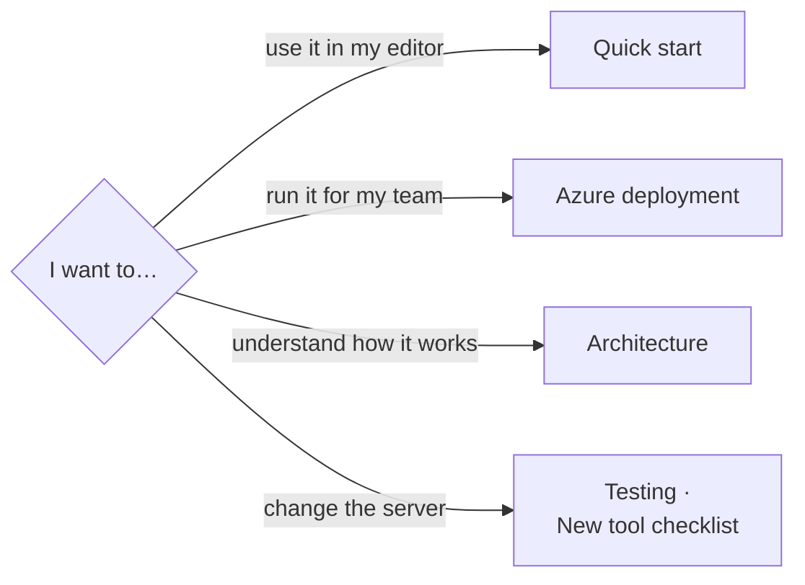

[README](../README.md) › Docs

# 📚 Documentation

Everything about the D365 F&O MCP Server, grouped by who you are and what you are doing. New here?
Start with the [project README](../README.md), then [Quick start](QUICK_START.md).

## 🚀 Getting started — developers using the server

| Page | What it covers |
|---|---|
| [Quick start](QUICK_START.md) | Connect to a deployed server in two minutes, or install on your D365FO VM in ten |
| [Setup guide](SETUP.md) | Scenarios A–F in detail: Azure client, hybrid, local HTTP, UDE, local stdio, multi-instance · Claude Code |
| [Usage examples](USAGE_EXAMPLES.md) | Five end-to-end scenarios with measured cost and the model to use |
| [Tool reference](MCP_TOOLS.md) | All 22 tools, their modes and example prompts |

## ⚙️ Configuration

| Page | What it covers |
|---|---|
| [`.mcp.json` reference](MCP_CONFIG.md) | Transports, context variables, path resolution, hybrid mode, junction layouts |
| [Configuration reference](CONFIGURATION.md) | Every setting the wizard writes, its default and environment variable *(generated)* |
| [Custom & ISV models](CUSTOM_EXTENSIONS.md) | Which models are yours, prefixes, extension naming, cross-model writes |

## 🧩 Features

| Page | What it covers |
|---|---|
| [Model lifecycle](MODEL_LIFECYCLE.md) | Create, edit and delete models — and why there is no rename |
| [Binary ISV models](BINARY_ISV_MODELS.md) | Index ISV models shipped as DLLs, signatures only |
| [AxDB SQL](AXDB_SQL.md) | Optional read-only SQL against AxDB on the dev VM |
| [Performance trace](TRACE.md) | Optional ETW capture: where X++ and SQL time goes |
| [AOS restart](AOS_RUNTIME_RESTART.md) | Optional runtime refresh after a build |

## ☁️ Operations — administrators

| Page | What it covers |
|---|---|
| [Azure deployment](SETUP_AZURE.md) | App Service + Blob Storage, authentication, DevOps pipelines that refresh the index |
| [Security policy](../SECURITY.md) | Reporting a vulnerability, what counts as one |

## 🏛️ Under the hood

| Page | What it covers |
|---|---|
| [Architecture](ARCHITECTURE.md) | Data sources, request flow, grounding gates, C# bridge, databases, deployment modes |
| [Eval loop](AGENT_EVAL_LOOP.md) | The self-improving harness that measures and fixes the server |
| [Coverage](../eval/COVERAGE.md) | What the coverage badge counts *(generated)* |

## 🤝 Contributing

| Page | What it covers |
|---|---|
| [Repository conventions](../CLAUDE.md) | No real customer names, a CHANGELOG entry with every change |
| [Testing](TESTING.md) | Running and writing tests, CI, round-trip cost baseline |
| [New tool checklist](NEW_TOOL_CHECKLIST.md) | What a new tool touches — and why merging into an existing one is usually better |
| [Knowledge authoring](KNOWLEDGE_AUTHORING.md) | Adding X++ knowledge topics past the three CI gates |
| [Backlog](BACKLOG.md) | Deferred and rejected work, with the evidence |
| [Changelog](../CHANGELOG.md) | What changed in each release |
