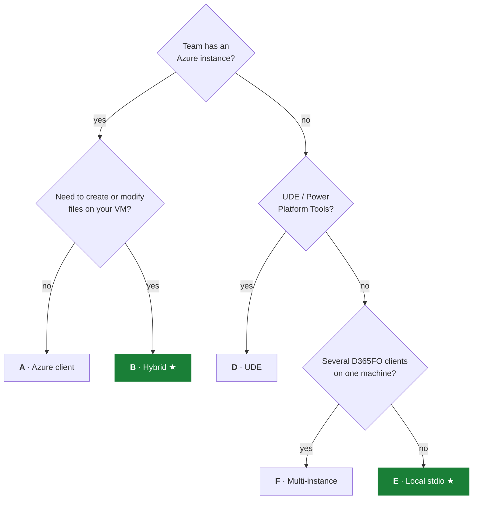
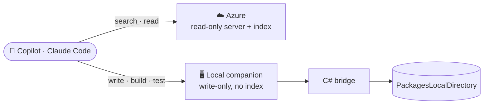

<sub>[README](../README.md) › [Docs](README.md) › Setup guide</sub>

# 🧩 Setup guide — client configuration

Everything a **developer** needs to connect GitHub Copilot (VS 2026 / VS 2022 ≥ 17.14, VS Code) or
Claude Code to the D365 F&O MCP Server — six scenarios, from "nothing installed" to several
D365FO environments on one machine.

> [!TIP]
> In a hurry? [QUICK_START.md](QUICK_START.md) is the short path. Deploying the shared Azure server
> (admins): [SETUP_AZURE.md](SETUP_AZURE.md). Claude Code: [below](#claude-code-cli).

**The wizard does most of this for you.** `d365fo-mcp setup` (run by the
[one-line installer](QUICK_START.md#2-install)) walks through the scenario choice below, builds the
bridge and the index, and prints the `.mcp.json` block. `d365fo-mcp doctor` verifies an existing
installation. Day-to-day: `npx d365fo-mcp start | update | index | instance …` — each command also
runs non-interactively with arguments. The PowerShell scripts referenced below keep working as
before.

**Configuration lives in `config/d365fo-mcp.json`**, written by the wizard (secrets in
`config/secrets.json`); the generated `.mcp.json` block points the server at it via
`D365FO_CONFIG`. Change one thing later with `npx d365fo-mcp config [section]`. Every setting, its
default and the environment variable it maps to: [CONFIGURATION.md](CONFIGURATION.md). A `.env` from
an older installation is still read as a fallback and is imported the first time setup runs.

---

## Choosing a scenario



| Scenario | Search index | Writes | Local install | Index build |
|---|---|---|---|---|
| **A** — Azure client | Azure | ❌ | none | none |
| **B** — Hybrid ★ | Azure | ✅ local bridge | npm package | none |
| **C** — Local HTTP | local | ✅ | npm package | yes |
| **D** — UDE | local | ✅ | npm package | yes |
| **E** — Local stdio ★ | local | ✅ | npm package | yes |
| **F** — Multi-instance | local ×N | ✅ | npm package | per instance |

★ = recommended: **B** for teams, **E** for a single developer.

---

## Prerequisites

| Component | Version | Needed for |
|---|---|---|
| Visual Studio 2026 / 2022 | 2026 (from 10.0.49) / ≥ 17.14 | MCP support |
| GitHub Copilot extension | latest | agent mode |
| Node.js | 24.x LTS | local & hybrid — the one-line installer adds it when missing |
| .NET SDK | any current | C# bridge — **all writes** (pre-installed on D365FO VMs) |
| Git | any | only for a git-checkout installation |

The index is SQLite served by Node's built-in `node:sqlite` — there is no native addon to compile,
so neither Python nor a C++ toolchain is needed.

> [!IMPORTANT]
> From platform update **10.0.49 (PU74)**, **Visual Studio 2026** is the only supported IDE for X++
> development — Microsoft no longer supports VS 2022. Earlier platform versions still use VS 2022
> ≥ 17.14. ([announcement](https://learn.microsoft.com/en-us/dynamics365/fin-ops-core/fin-ops/get-started/whats-new-platform-updates-10-0-49))

## Enable MCP (one-time)

1. [github.com/settings/copilot/features](https://github.com/settings/copilot/features) → **MCP
   servers in Copilot**
2. VS → **Tools → Options → GitHub → Copilot** → **Enable MCP server integration in agent mode**
3. Copilot Chat → **Agent Mode** (tools only appear there)

## Place copilot-instructions.md (mandatory)

```powershell
Copy-Item -Path ".github" -Destination "C:\source\repos\" -Recurse
```

VS searches `.github\copilot-instructions.md` upward from the solution folder — one copy in a
common parent covers all solutions. It delivers the workflow rules (tool routing,
confirm-before-write, no terminal file edits) the agent depends on.

> [!WARNING]
> The fuller `xpp_system_instructions` MCP prompt is **opt-in** and must be invoked manually — never
> rely on it alone.

---

## Scenario A — Azure client

Team server on Azure; you connect read-only. No local install, no index.

```json
{
  "servers": {
    "d365fo-mcp-tools": { "url": "https://your-server.azurewebsites.net/mcp/" }
  }
}
```

> [!NOTE]
> Cannot write files on your VM and cannot read your workspace context reliably (HTTP has no
> `env`). For real development use **Scenario B**.

## Scenario B — Hybrid (Azure search + local writes) ★

Azure serves the shared index; a lightweight local companion (starts < 1 s, no database) handles
writes via the C# bridge. Copilot merges both tool lists and routes automatically.



Install with the [one-line installer](QUICK_START.md#2-install) and pick **B — Hybrid** in the
wizard: it sets `server.mode: write-only`, asks for the workspace and solutions path, builds the
bridge and skips the local index. Then add both servers:

```json
{
  "servers": {
    "d365fo-azure": { "url": "https://your-server.azurewebsites.net/mcp/" },
    "d365fo-local": {
      "command": "node",
      "args": ["K:\\d365fo-mcp-server\\dist\\index.js"],
      "env": {
        "D365FO_CONFIG": "K:\\d365fo-mcp-server\\config\\d365fo-mcp.json"
      }
    }
  }
}
```

`D365FO_CONFIG` points at the file the wizard wrote — it already holds `server.mode: write-only`,
the workspace and the solutions path for this companion. Add a variable to the `env` block only to
override the file for that one server entry. The wizard prints this block with your real paths.

The local companion also exposes the bridge-backed reader `get_object_info` (including its
`options.method` form), so freshly created objects are immediately readable without waiting for an
Azure index refresh.

**Update:** `npx d365fo-mcp update` whenever a new version ships — it reinstalls an npm
installation from the registry, or runs `git pull`, `npm install` and the build in a git checkout.

<details>
<summary>From a git checkout instead</summary>

<br/>

```powershell
git clone https://github.com/dynamics365ninja/d365fo-mcp-server.git K:\d365fo-mcp-server
cd K:\d365fo-mcp-server
npm install
cd bridge\D365MetadataBridge; dotnet build -c Release; cd ..\..
npm run build
npm run setup
```

</details>

## Scenario C — Local HTTP

Everything on your VM, served over `http://localhost:8080`.

```powershell
npx d365fo-mcp setup       # pick C — packages path, custom models, prefix, port
npx d365fo-mcp index       # extract + build the index — custom models: minutes; full index: 1–2 h
npx d365fo-mcp start       # verify: http://localhost:8080/health
```

```json
{
  "servers": {
    "d365fo-mcp-tools": { "url": "http://localhost:8080/mcp/" }
  }
}
```

> [!TIP]
> Prefer **Scenario E** (stdio) when a single client drives the server — no port, no manual start,
> the editor launches it for you. Choose local HTTP when **several clients share one code base**
> (e.g. VS Code + the CLI at the same time): stdio spawns one subprocess per client, each loading
> its own ~1.5 GB index, whereas a single HTTP instance loads the index once and serves them all.

## Scenario D — UDE (Unified Developer Experience)

The server reads your XPP config from `%LOCALAPPDATA%\Microsoft\Dynamics365\XPPConfig\`
automatically — usually no paths needed.

```json
{
  "servers": {
    "d365fo-mcp-tools": {
      "command": "node",
      "args": ["K:\\d365fo-mcp-server\\dist\\index.js"],
      "env": {
        "D365FO_CONFIG": "K:\\d365fo-mcp-server\\config\\d365fo-mcp.json"
      }
    }
  }
}
```

If auto-detection fails, add `D365FO_CUSTOM_PACKAGES_PATH` and `D365FO_MICROSOFT_PACKAGES_PATH`
explicitly. For metadata extraction run `npm run select-config` first. Bridge build on UDE needs the
DLL path:

```powershell
dotnet build -c Release -p:D365BinPath="<FrameworkDirectory>\bin"
```

If you are *changing* bridge sources rather than just deploying them, build with
`npm run bridge:build` instead — see
[Changing bridge sources](#changing-bridge-sources--use-npm-run-bridgebuild).

## Scenario E — Local stdio ★ (single developer)

The editor spawns the server as a subprocess — no HTTP, no manual start. Build the index as in
Scenario C, then:

```json
{
  "servers": {
    "d365fo-mcp-tools": {
      "command": "node",
      "args": ["C:\\d365fo-mcp-server\\dist\\index.js"],
      "env": {
        "D365FO_CONFIG": "C:\\d365fo-mcp-server\\config\\d365fo-mcp.json"
      }
    }
  }
}
```

The database paths and `workspace.solutionsPath` come from the config file; the `env` block only
has to say which config to load. `workspace.solutionsPath` is scanned for `.rnrproj` files at
startup; the MCP roots protocol delivers the open workspace automatically. Switch projects without
restart via `get_workspace_info(projectPath=...)`. Details:
[MCP_CONFIG.md § Automatic workspace detection](MCP_CONFIG.md#automatic-workspace-detection)

## Scenario F — Multiple instances

One machine, several D365FO clients — each instance gets its own config file, database and port:

```powershell
npx d365fo-mcp instance add             # name + port, then the same questions as `setup`,
                                        # → instances\<name>\{d365fo-mcp.json,data,metadata}
npx d365fo-mcp instance rebuild clientA # first build: extract + build index (--all for all instances)
npx d365fo-mcp instance run clientA     # start on its port
```

`instance upgrade <name>` repoints an instance at a new XPP config after a UDE version upgrade and
rebuilds it. Each command is interactive when the name is omitted. To run an instance manually,
point the server at its config: `D365FO_CONFIG=instances\clientA\d365fo-mcp.json node dist\index.js`.

Provisioning instances from a script instead of interactively? Copy
`instances\d365fo-mcp.template.json` to `instances\<name>\d365fo-mcp.json` and fill in the blanks.
The `instances\*.ps1` scripts remain for installations still configured through per-instance
`.env` files.

> [!WARNING]
> **Instance config under `instances\<name>\config\`?** Some builds wrote it one level deeper. Such
> an instance still runs, but `D365FO_CONFIG=instances\<name>\d365fo-mcp.json` as written above then
> names a file that does not exist and the server starts on defaults. `d365fo-mcp doctor` flags it;
> `instance upgrade <name>` moves `d365fo-mcp.json` and `secrets.json` up one level, or move the two
> files yourself.

### Keeping instances in sync

Updating the server code and reindexing an instance's database are **separate** steps, at different
scopes:

- **Server binaries are global.** All instances run the same installation, so update it once —
  never per instance — then restart the instances:
  ```powershell
  npx d365fo-mcp update
  ```
- **Databases are per-instance.** `rebuild-instance.ps1` runs a full reindex from the current
  source. Only reindex when it's actually needed:

  | What changed | Command |
  |---|---|
  | First build of an instance | `rebuild-instance.ps1 <name>` |
  | **Microsoft base** upgraded (UDE version) | `upgrade-instance.ps1 <name>` |
  | The update changed the **parser / DB schema** | `rebuild-instance.ps1 --all` |
  | Runtime-only code change | *(just update + restart — no reindex)* |

  Add `--all` to rebuild every instance.

> [!NOTE]
> `rebuild-instance.ps1` deliberately does **not** update or build the server: that is a global
> action, and doing it while rebuilding a single instance would leave the others running new
> binaries against an old-schema database.

Point a per-solution `.mcp.json` at the right port:

```json
{
  "servers": {
    "d365fo-clientA": { "url": "http://localhost:3001/mcp/" }
  }
}
```

`npx d365fo-mcp doctor` checks every instance after an upgrade: index size, a pinned XPP config that
no longer resolves, and any legacy `.env` that contradicts the instance config.

### BP moniker catalog

Each instance also gets its own `data\bp-moniker-catalog.json`, extracted from *that instance's*
pinned D365FO version rather than the one shared snapshot compiled into the server
(`src/knowledge/bpMonikers/catalog.generated.ts`) — clientA on 10.0.35 and clientB on 10.0.40 each
see their own real moniker set instead of whichever box's snapshot happens to be checked in.

It regenerates automatically as part of `instance rebuild`/`upgrade` (and the first-time `setup`
wizard), only when the instance's resolved version has actually moved since the catalog was last
stamped — every other rebuild is a no-op. Requires `pwsh` or `powershell.exe` on PATH; if neither
is found, or extraction fails, the previous catalog (or the compiled-in default, if none exists
yet) stays in use and a warning is logged — a stale BP catalog never blocks the metadata reindex.

---

## Building the C# bridge

**Mandatory on Windows D365FO VMs** — writes (`d365fo_file` action=create/modify) need it. Without
it the server runs read-only. The wizard builds it for you; to build it by hand:

```powershell
cd bridge\D365MetadataBridge
dotnet build -c Release        # output: bin\Release\D365MetadataBridge.exe (auto-detected)
```

Every build also writes `D365MetadataBridge.sources.json` next to the exe: a hash of the sources it
compiled. An update can change those sources and leave the exe in place (`git pull` never touches
`bin\Release`; `npm install -g` never touches the data directory), so `d365fo-mcp update` requires
a rebuild when the stamp is missing or differs, and `d365fo-mcp doctor` warns about it.

### Changing bridge sources — use `npm run bridge:build`

The command above deploys a binary; it does **not** refresh `bridge/build-attestation.json`. That
file holds a hash of the bridge sources and is the only evidence they compile, because no CI runner
can build them — the D365FO metadata assemblies exist solely on a development machine. Edit
anything under `bridge/` without refreshing it and the `bridge-attestation` check fails with
`bridge sources changed but the attestation did not`.

From the repo root:

```powershell
npm run bridge:build           # compiles, then rewrites bridge/build-attestation.json
```

Commit the refreshed `build-attestation.json` in the same change. The build goes to a scratch
directory, so it is safe to run while an MCP client holds a lock on the deployed binary — and for
the same reason it does **not** update `bin\Release`. Run the plain `dotnet build` above when you
want the deployed binary replaced.

> [!IMPORTANT]
> **On a UDE box, pass the DLL path as an environment variable.** `bridge:build` does not forward
> `-p:D365BinPath`, and the project file only probes drive-letter
> `<X>:\AosService\PackagesLocalDirectory\bin` locations, which a UDE install does not have.
> MSBuild reads environment variables as properties, so this reaches the project file unchanged:
>
> ```powershell
> $env:D365BinPath = "$env:LOCALAPPDATA\Microsoft\Dynamics365\<version>\PackagesLocalDirectory\bin"
> npm run bridge:build
> ```

It fails loudly rather than attesting a build that never saw the references —
`Build succeeded but no metamodel version was reported … refusing to attest it`. A good run names
the version it compiled against: `Bridge compiles against metamodel 7.0.xxxx.xxx from <path>`.

| Situation | Action |
|---|---|
| UDE box (DLLs not in `PackagesLocalDirectory\bin`) | `dotnet build -c Release -p:D365BinPath="<FrameworkDirectory>\bin"` |
| You edited anything under `bridge/` | `npm run bridge:build` (see above) and commit the refreshed `bridge/build-attestation.json` |
| `NU1101` restoring `System.Text.Json` / `Microsoft.NETFramework.ReferenceAssemblies.net48` | The bridge ships its own `NuGet.config` that merges nuget.org into whatever offline sources the VM already has, so this is usually already fixed. If it still fails (nuget.org blocked outright), restore once with `dotnet restore --source https://api.nuget.org/v3/index.json` |
| After a D365FO version upgrade | rebuild to pick up new DLLs |

Healthy startup: `✅ C# bridge initialized (metadataAvailable: true, xrefAvailable: true)`.
`xrefAvailable: false` is non-critical (xref tools fall back to SQLite FTS). Full reference:
[ARCHITECTURE.md § C# Metadata Bridge](ARCHITECTURE.md#c-metadata-bridge)

---

## Where to place .mcp.json

| Location | Scope | Use when |
|---|---|---|
| `%USERPROFILE%\.mcp.json` | all solutions | one environment for everything (recommended) |
| next to the `.sln` | that solution only | per-project servers/ports (Scenario F) |

The server searches from the working directory up to 5 parent levels.

---

## Troubleshooting

| Symptom | Fix |
|---|---|
| Tools don't appear in Copilot | VS ≥ 17.14 · MCP enabled on github.com **and** in VS options · Agent Mode active · restart VS after editing `.mcp.json` |
| Copilot uses built-in file search instead of tools | `.github\copilot-instructions.md` must exist in a parent of the solution folder |
| File created in the wrong model | use the two-level `D365FO_WORKSPACE_PATH`: `...\PackagesLocalDirectory\<Package>\<Model>` — see [MCP_CONFIG.md § Automatic workspace detection](MCP_CONFIG.md#automatic-workspace-detection) |
| Local companion won't start | `node --version` (24.x) · `npx d365fo-mcp doctor` · check the path in `args` |
| Writes fail / bridge missing | build the bridge (above) · check `.NET 4.8` · see startup log flags |
| No search results | Azure: open `/health` in a browser · local: `data/xpp-metadata.db` exists and is > 100 MB |

---

## Claude Code CLI

Same installation as above — no Visual Studio required. Register the server with
`claude mcp add-json`; the **`alwaysLoad`** flag loads the tool list at session start so Claude
never routes X++ lookups to another tool.

```powershell
# Azure-hosted server (most teams)
claude mcp add-json --scope user d365fo-mcp-tools '{"type":"http","url":"https://your-server.azurewebsites.net/mcp/","alwaysLoad":true}'

# Local stdio (single developer)
claude mcp add-json --scope user d365fo-mcp-tools '{"type":"stdio","command":"node","args":["K:\\d365fo-mcp-server\\dist\\index.js"],"env":{"D365FO_CONFIG":"K:\\d365fo-mcp-server\\config\\d365fo-mcp.json"},"alwaysLoad":true}'
```

`npx d365fo-mcp connect <url> --client claude` does the first one for you.

For a team-shared, project-scoped config, create `.mcp.json` in the solution root using Claude
Code's **`mcpServers`** key (not `servers`). Finally, copy `.github/copilot-instructions.md` to the
parent of your solutions renamed to **`CLAUDE.md`** — Claude Code reads it automatically from the
working directory upward.

---

## Next steps

| Topic | Documentation |
|---|---|
| Every `.mcp.json` option | [MCP_CONFIG.md](MCP_CONFIG.md) |
| All 22 tools | [MCP_TOOLS.md](MCP_TOOLS.md) |
| Real workflows | [USAGE_EXAMPLES.md](USAGE_EXAMPLES.md) |
| ISV / multi-model setups | [CUSTOM_EXTENSIONS.md](CUSTOM_EXTENSIONS.md) |
| Automated index refresh | [SETUP_AZURE.md § pipelines](SETUP_AZURE.md#azure-devops-pipelines) |
