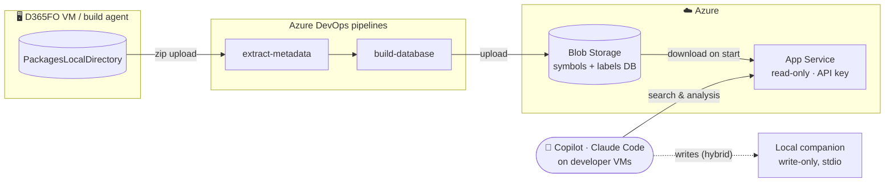
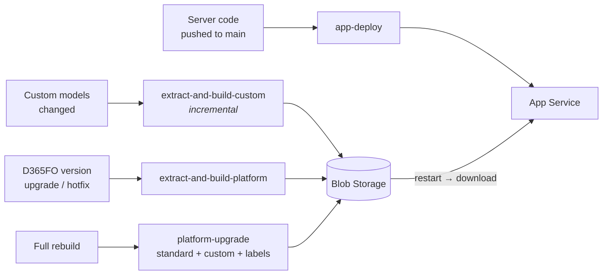

<sub>[README](../README.md) › [Docs](README.md) › Azure deployment</sub>

# ☁️ Azure deployment

Deploy one shared D365 F&O MCP Server for the whole team on Azure App Service. The metadata index
lives in Blob Storage and downloads automatically when the app starts.

> [!NOTE]
> This page is for whoever **administers** the shared server. A developer who only wants to **use**
> an existing server needs [QUICK_START.md](QUICK_START.md) (Path A) or [SETUP.md](SETUP.md)
> (Scenario A / B) instead.

**On this page:** [What you need](#what-you-need) ·
[Architecture](#architecture-overview) ·
[1 Resources](#step-1--create-azure-resources) ·
[2 App settings](#step-2--configure-app-settings) ·
[3 Deploy](#step-3--deploy-the-application) ·
[4 Index](#step-4--build-and-upload-the-metadata-database) ·
[5 Verify](#step-5--verify) ·
[Pipelines](#azure-devops-pipelines)

---

## What you need

- **Node.js** 24.x LTS (for building the application and metadata on your Windows VM)
- **Git**
- An Azure subscription with permissions to create App Service and Storage Account

The server has no native addons — SQLite comes from Node's built-in `node:sqlite` — so no Python or
C++ toolchain is needed, and a build made on Windows runs unchanged on App Service Linux.

---

## Architecture overview



**Azure resources:**

| Resource | Purpose | Minimum SKU |
|---|---|---|
| Azure Blob Storage | Stores `xpp-metadata.db` (~2–3 GB depending on UnitTest models) and the labels database (~500 MB) | Standard LRS |
| Azure App Service Plan | Hosts the Node.js server | B3 (dev/test), P0v3 (production) |
| Azure App Service (Web App) | Runs the MCP server | Linux, Node 24 LTS |

---

## Step 1 — Create Azure resources

> [!TIP]
> The **Deploy to Azure** button creates everything in this step plus the app settings and startup
> command from step 2 in one go:
>
> [](https://portal.azure.com/#create/Microsoft.Template/uri/https%3A%2F%2Fraw.githubusercontent.com%2Fdynamics365ninja%2Fd365fo-mcp-server%2Frefs%2Fheads%2Fmain%2Finfrastructure%2Fazuredeploy.json)
>
> The template is [`infrastructure/azuredeploy.json`](../infrastructure/azuredeploy.json), built
> from [`main.bicep`](../infrastructure/main.bicep).

By hand, in the **Azure Portal**:

1. Create a **Resource Group** in your chosen region.
2. Create a **Storage Account** (Standard LRS, StorageV2), and inside it two **Blob Containers**:
   - `xpp-metadata` — receives the built metadata databases
   - `packages` — receives the raw `PackagesLocalDirectory.zip` used by CI pipelines
3. Create an **App Service Plan**: OS **Linux**, SKU **P0v3** (production) or **B3** (dev/test).
4. Create a **Web App (App Service)** on that plan: runtime stack **Node 24 LTS**, **HTTPS only**.
5. Enable **System-assigned managed identity** on the Web App
   (Web App → Settings → Identity → System assigned → On).

---

## Step 2 — Configure app settings

In the Azure Portal, go to the App Service → **Settings** → **Environment variables** and add:

| Setting | Value | Notes |
|---|---|---|
| `AZURE_STORAGE_CONNECTION_STRING` | Connection string | Storage Account → Access keys → Connection string |
| `BLOB_CONTAINER_NAME` | `xpp-metadata` | Container that holds the uploaded databases |
| `BLOB_DATABASE_NAME` | `databases/xpp-metadata-latest.db` | Blob path within the container |
| `DB_PATH` | `/tmp/xpp-metadata.db` | Local path where the database is downloaded |
| `LABELS_DB_PATH` | `/tmp/xpp-metadata-labels.db` | Local path for the labels database |
| `LABEL_LANGUAGES` | e.g. `en-US,cs,de` | Comma-separated; each language adds ~125 MB |
| `MCP_SERVER_MODE` | `read-only` | Hides the local build/verify tools; developers use a local companion for writes |
| `NODE_ENV` | `production` | |
| `SCM_DO_BUILD_DURING_DEPLOYMENT` | `false` | The deploy zip already contains `node_modules` — Oryx must not run `npm ci` |
| `WEBSITE_NODE_DEFAULT_VERSION` | `~24` | |

### Authentication (required)

> [!CAUTION]
> An App Service is reachable from the public internet the moment it is created, and its hostname
> is predictable: it is derived from the resource group name
> (`d365fo-mcp-server-<customer>.azurewebsites.net`) and published in Certificate Transparency
> logs. Without a key, **anyone who reaches that URL can read your entire indexed model** — X++
> source snippets, extension and event-handler wiring, security roles and privileges, and label
> text.

The server therefore refuses to start in HTTP mode when it would bind a network-reachable address
with no key configured. With no key and no explicit `HOST`, it binds `127.0.0.1` instead — which on
App Service means the health probe never goes green, so a keyless deployment fails visibly rather
than quietly serving your model to the internet.

| Setting | Value | Notes |
|---|---|---|
| `API_KEY` | `openssl rand -hex 32` | All `/mcp` requests must include an `X-Api-Key` header (or `Authorization: Bearer <key>`). `/health` and `/` stay public so Azure probes work. |

<details>
<summary>Deployments that authenticate upstream</summary>

<br/>

If you front the App Service with **Easy Auth / Entra ID**, a **Private Endpoint**, or an
authenticating reverse proxy, set `ALLOW_UNAUTHENTICATED=true` to acknowledge that and skip the
startup check.

> [!WARNING]
> Do not set it to silence the error — it disables the only authentication this server performs.

</details>

### Startup command

Set the **Startup Command** under **Settings → Configuration**:

```
bash startup.sh
```

---

## Step 3 — Deploy the application

Use the **Azure DevOps pipeline** `d365fo-mcp-app-deploy` (recommended — builds the deploy zip and
ships it on every push to `main`).

For a **manual one-time deploy** from your Windows machine:

1. Clone the repository, build, and package:

   ```powershell
   git clone https://github.com/dynamics365ninja/d365fo-mcp-server.git
   cd d365fo-mcp-server
   npm install
   npm run build
   # node_modules is portable: the server has no native addons (SQLite comes from node:sqlite)
   Compress-Archive -Path dist, node_modules, package.json, package-lock.json, startup.sh `
     -DestinationPath deploy.zip
   ```

2. Upload via the Portal: Web App → **Deployment Center** → **Deploy** → upload `deploy.zip`.

> [!NOTE]
> A `node_modules` produced on Windows runs unchanged on App Service Linux — build the zip wherever
> is convenient. `SCM_DO_BUILD_DURING_DEPLOYMENT` stays `false`: the dependencies are already in the
> zip and nothing needs compiling on the host.

---

## Step 4 — Build and upload the metadata database

### Option A — Azure DevOps pipelines (recommended)

See [Azure DevOps pipelines](#azure-devops-pipelines). Pipelines handle extraction, build and upload
automatically.

### Option B — Manual (from your Windows VM)

1. Configure the server on your VM — `d365fo-mcp setup` (or `npx d365fo-mcp config`) writes
   `environment.packagePath`, `environment.customModels` and the Azure storage secrets; the
   equivalent environment variables are `D365FO_PACKAGE_PATH`, `CUSTOM_MODELS`,
   `AZURE_STORAGE_CONNECTION_STRING`, `BLOB_CONTAINER_NAME` ([CONFIGURATION.md](CONFIGURATION.md)).
2. Extract and build:

   ```powershell
   npm run extract-metadata
   npm run build-database
   ```

3. Upload `data/xpp-metadata.db` and `data/xpp-metadata-labels.db` to the `xpp-metadata` container
   using **Azure Storage Explorer** or the portal.

The App Service downloads the databases automatically on the next cold start or restart.

---

## Step 5 — Verify

Open the Web App URL in a browser or call:

```
https://<your-app>.azurewebsites.net/health
```

Expected response:

```json
{"status":"ok","mode":"read-only", ...}
```

Then connect a client ([QUICK_START.md § Path A](QUICK_START.md#path-a--connect-to-a-server-someone-else-deployed))
and confirm the tool list matches `read-only` mode: everything except the eight local build/verify
tools (see [MCP_CONFIG.md § Hybrid mode summary](MCP_CONFIG.md#hybrid-mode-summary)).

---

## Azure DevOps pipelines

Four ready-to-use pipelines in [`.azure-pipelines/`](../.azure-pipelines) automate extraction,
database builds and deployment:

| Pipeline | When to use | Trigger | Duration |
|---|---|---|---|
| `d365fo-mcp-app-deploy` | server code changed | auto on push to `main` | ~5–10 min |
| `d365fo-mcp-data-extract-and-build-custom` | custom models changed | manual | ~15–30 min |
| `d365fo-mcp-data-extract-and-build-platform` | D365FO version upgrade / hotfix | manual | ~60–120 min |
| `d365fo-mcp-data-platform-upgrade` | full rebuild: standard + custom + labels | manual | ~90–120 min |



The custom pipeline is **incremental** — it downloads the existing symbols DB and replaces only your
models. Key parameters: `customModels` (comma-separated names for a targeted ~5–10 min update),
`skipExtraction=true` (rebuild the DB from blob metadata only, no source extraction).

The upgrade pipeline builds in two passes (symbols, then `npm run build-fts`) to stay inside the
agent's 4 GB heap and requires custom metadata already in blob — run the custom pipeline first if
unsure. Every data pipeline ends with an App Service restart so the fresh database is downloaded.

### Required variable group

Create a variable group named **`xpp-mcp-server-config`** in the Azure DevOps Library:

| Variable | Secret | Example value |
|---|---|---|
| `AZURE_STORAGE_CONNECTION_STRING` | Yes | Connection string from Azure Portal |
| `BLOB_CONTAINER_NAME` | No | `xpp-metadata` |
| `CUSTOM_MODELS` | No | `MyPackage` |
| `AZURE_SUBSCRIPTION` | No | Name of your Azure DevOps service connection |
| `AZURE_APP_SERVICE_NAME` | No | `xpp-mcp-server` |

### Object source in the database

Every object's original XML is stored (gzipped, table `object_source`; extensions excluded) so a
host with only the database can read it. Measured on one full standard install (about 187,000
objects): 1.8 GiB of XML, **about 330 MiB gzipped** in the database, led by reports (120 MiB,
embedded RDL), classes (95 MiB), tables (37 MiB) and forms (36 MiB); gzip adds about 90 s of CPU to
a full build. The extractor attaches the XML to each JSON as `raw`, so blob JSON grows by roughly
the escaped XML size (about +1.8 GiB for a full standard extract), which costs storage and download
time.

> [!IMPORTANT]
> Existing blob JSON has no `raw`; objects from it have no stored copy until re-extracted. Run, in
> this order:
>
> 1. the **platform pipeline with extraction** (not `skipExtraction`) for the standard models,
> 2. the **custom pipeline with extraction**,
> 3. the upgrade pipeline, if you use it.
>
> The upgrade pipeline and custom `skipExtraction` runs rebuild from blob JSON and only get stored
> copies if that JSON carries `raw`. `form_datasources` (which forms use a table) needs no
> re-extraction.

Upgrading from 1.22.0: its forms-only `form_source` table is no longer read, so forms lose their
stored copy until the database is rebuilt this way. Run the pipelines before the App Service
restarts on the new version.

### Uploading standard packages

The platform pipeline needs the raw `PackagesLocalDirectory` as a zip in the `packages` container.
On your D365FO VM, compress `K:\AosService\PackagesLocalDirectory`, upload it as
`PackagesLocalDirectory.zip` (via **Azure Storage Explorer**), and re-upload only after a version
upgrade or hotfix rollup.

---

## Next steps

| Topic | Documentation |
|---|---|
| Connect developers to the new server | [QUICK_START.md § Path A](QUICK_START.md#path-a--connect-to-a-server-someone-else-deployed) |
| Hybrid write companion on each VM | [SETUP.md § Scenario B](SETUP.md#scenario-b--hybrid-azure-search--local-writes-) |
| Every setting and environment variable | [CONFIGURATION.md](CONFIGURATION.md) |
| What `read-only` does and does not protect | [MCP_CONFIG.md § Hybrid mode summary](MCP_CONFIG.md#hybrid-mode-summary) |
