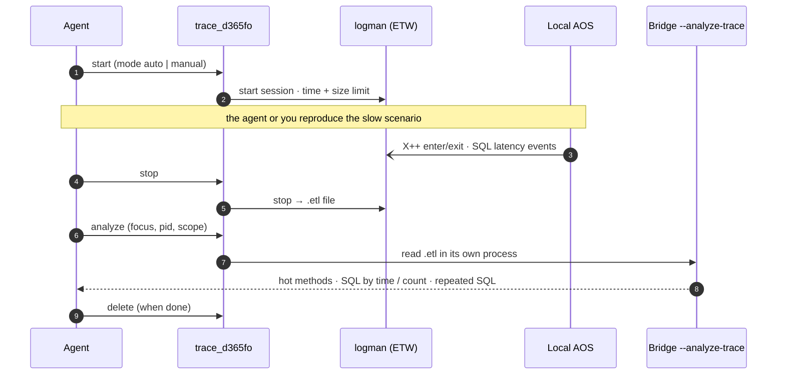

<sub>[README](../README.md) › [Docs](README.md) › Performance trace</sub>

# ⏱️ ETW performance trace (optional)

`trace_d365fo` measures where a slow D365FO process spends its time — which X++ methods, which SQL
statements, which callers run the same query thousands of times — without changing the
application. It replaces the usual approach of an agent adding timer classes, CoC wrappers or
`info()` calls around suspect methods, rebuilding, running, and removing them again.

It captures the AOS's own ETW events (the same ones Trace Parser reads) with `logman`, and
analyses the `.etl` file in the bridge binary. Trace Parser is not needed.



## Requirements

- A D365FO development VM with its local AOS (Windows).
- MCP running under an account allowed to start ETW sessions: a member of **Administrators** or
  **Performance Log Users**. Otherwise `start` answers `TRACE_ACCESS_DENIED`.
- The bridge built from these sources (`dotnet build bridge/D365MetadataBridge -c Release`): the
  analysis runs as `D365MetadataBridge.exe --analyze-trace` in its own process. It needs only the
  binary, so it works even when the long-running bridge did not start (no packages path, a start-up
  timeout on a cold VM).

> [!WARNING]
> Disk space: a capture grows by roughly 2 MB/s on an idle AOS and **40–50 MB/s** under a busy
> batch job. A 60-second capture of a heavy job can take 3 GB.

## Setup

```powershell
d365fo-mcp config trace
```

From a git checkout, use `npx tsx src/cli/index.ts config trace`.

| Setting | Env | Default | |
|---|---|---|---|
| `trace.enabled` | `D365FO_TRACE_ENABLED` | `false` | Publishes the tool. Off, it costs nothing. |
| `trace.outputDir` | `D365FO_TRACE_DIR` | — | Folder for captures. |
| `trace.maxSeconds` | `D365FO_TRACE_MAX_SECONDS` | `120` | Longest capture (10–900). |
| `trace.maxSizeMB` | `D365FO_TRACE_MAX_SIZE_MB` | `4096` | Largest file (100–20000); `logman` stops by itself there. |

> [!IMPORTANT]
> Restart MCP after saving.

Each capture gets its own size limit: its `seconds` × 50 MB (at least 200 MB), never more than
`trace.maxSizeMB`, not even for that minimum — a 30-second capture stops at 1,500 MB. `start`
reports it as `sizeLimitMB`; `status` shows the configured ceilings under `limits`.

**Folder.** When no folder is set yet, or the folder lacks space for the capture asked, `start`
does not start: it answers `TRACE_LOCATION_NEEDED` with every drive and its free space, the agent
asks you which folder to use, and the folder you choose is remembered in `trace-settings.json`
beside the index database for the next captures. A configured `trace.outputDir` always wins: an
`outputDir` the agent passes is then ignored. A drive root is refused as the folder, because
`analyze` (with `file`) and `delete` accept only captures inside the trace folder; so is a relative
path. The drives are probed off the event loop with the same letters and 2-second budget as the
packages-root scan: on a machine with a disconnected mapped drive the letters behind it are listed
under `drivesNotProbed`, and `environment.scanDrives` (`D365FO_SCAN_DRIVES`) pins the set.
Nothing is written to the system drive unless you choose it.

## Two ways to capture

- **`mode: "auto"`** — the agent reproduces the scenario itself right after `start`: through a
  browser extension it controls (Claude in Chrome, Codex's browser), or by running the job. Then
  `stop` and `analyze`, in one go.
- **`mode: "manual"`** — `start`, then the agent tells you what to do in the D365FO client and
  waits; you do it, say you are done, and the agent calls `stop`. Use it when the scenario needs a
  person, data the agent should not touch, or a client the agent cannot drive.

Either way the capture ends by itself at the time limit or the size limit, even if nobody calls
`stop`. The deadline is also checked on every call and when the server starts, and the server
stops its capture when it shuts down (the client closing the session), so a capture does not
outlive the session that started it. Only one capture runs at a time on the VM, across MCP
instances: `stop` — and the shutdown of a server — ends only the capture this server started (or one
whose server no longer runs), even when several instances share one index, and a session started
elsewhere is reported, not stopped. If `logman` fails to stop a capture at its time limit, the
capture stays recorded as running and the stop is retried every 30 s. If the capture's state file
cannot be written (the folder of the index database is not writable), `start` stops the capture
again at once and answers `TRACE_STATE_FAILED`: nothing could have stopped it later.

> [!TIP]
> Run the scenario once untraced first (the first run pays for caches), keep captures short, and
> for a job that runs for hours capture a representative minute in the middle.

## What `analyze` returns

`analyze` reads the capture in its own process (about 15,000 events/s — a 60-second capture of a
busy batch can take minutes) and answers within `waitSeconds` with the result, or with the
progress so far; asking again with the same arguments returns the result when it is ready. Results
are kept beside the capture (`<file>.analysis.<hash>.json`) and reused.

- `focus` — method-name substrings that pick the threads to analyse (e.g. the batch task class),
  so background activity on other threads does not dilute the result. `pid` restricts to one
  process. `scope: "subtree"` counts only time below the focus method.
- `topExclusive` / `topInclusive` / `topCalls` — X++ methods by own time, by time including
  callees, by call count; each with the SQL time issued directly and beneath it.
- `topSqlByTime` / `topSqlByCount` — statements with executions, total, preparation, max and their
  top callers. Statements are told apart by their whole text (whitespace collapsed, session temp-table
  names reduced to the table id); the text shown is shortened to 300 characters, and when the column
  list is longer it keeps only its head and then `FROM … WHERE`, which names the table and the filter. `repeatedSql` — one caller running the same statement
  at least 50 times: the per-record query in a loop that set-based code or a cache would remove.
- `topRowFetch`, `totals` (SQL share of the selected threads' busy time), `threads`, `openAtEnd`,
  `pairing` and `caveats`.

## Accuracy

The analysis pairs each method's enter and exit per thread on a stack, so recursion and nesting
are counted once; exclusive time is inclusive time minus direct callees. SQL latency events come
after the statement ran and are charged to the X++ method on top of the stack, and rolled up to
its callers. What it cannot know is stated, not guessed:

- **ETW overhead.** Every method event costs time, which inflates small, frequently called
  methods. Rankings and ratios are reliable; absolute seconds are not the untraced run's.
- Exits whose enter came before the capture are counted and ignored; frames still open at the end
  are listed in `openAtEnd` with their time so far (a lower bound); a frame closed by an outer
  method's exit (a lost event) is counted and its time is an upper bound. An exception does not
  cause this: unwinding X++ methods still log their exits, whether the exception is caught or
  reaches the infolog (measured on a development VM).
- The share of SQL is computed over `busySeconds`: the time the selected threads spent inside X++
  frames, plus SQL issued outside any frame. Not the wall-clock span, and not the threads' spans,
  which an idle pool thread would dilute. In a capture taken mid-run, time in the outer method's own
  code before its first traced callee is not seen, so busy time is a lower bound.

## Customer data

> [!CAUTION]
> A capture contains SQL parameter values, user ids and machine names. The tool never returns
> parameter values (bind events are only counted). Keep captures on the VM, do not copy them
> elsewhere, and delete them when the analysis is done: `trace_d365fo(action: "delete", file)`
> removes a capture and its analyses (only inside the trace folder).
